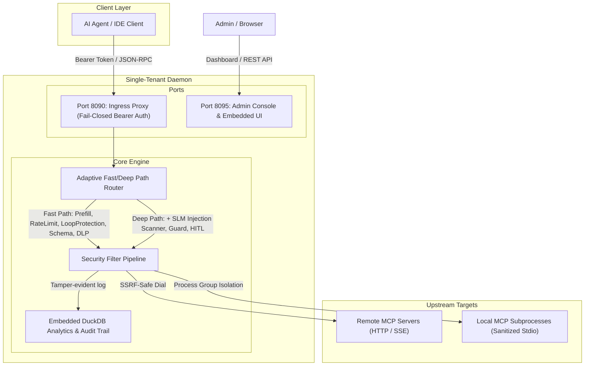

# FaradAiWire 🛡️

[](LICENSE)
[](go.mod)
[](#-open-core--enterprise-edition-fawee)

FaradAiWire is a lightweight, zero-trust security gateway for AI agents, specifically protecting against Model Context Protocol (MCP) threats, prompt injection, sensitive data leakage, and malicious agent skills.

Designed for enterprise and developer workflows, it acts as a high-performance Policy Enforcement Point (PEP) between AI agents (Claude Code, Cursor, Copilot, custom LLM runners) and upstream MCP servers.

---

## 🏗️ Architecture

FaradAiWire implements strict physical port segregation, dual-transport proxying (SSE & Stdio), and an adaptive security filter pipeline.



---

## ⚡ Quick Start (Native Installation)

FaradAiWire runs as a lightweight, single-tenant native background daemon on developer workstations with zero virtualization overhead.

### 🍎 macOS (Homebrew - Recommended)
```bash
brew tap FaradAiLab/tap
brew install faradaiwire

# Run in foreground:
faradaiwire run

# Or manage as a background service:
brew services start faradaiwire
```

### 🐧 Linux & macOS (Single-Command Shell)
```bash
curl -fsSL https://raw.githubusercontent.com/FaradAiLab/FaradAiWire/main/install.sh | sh
faradaiwire run
```

### 🪟 Windows (PowerShell)
```powershell
irm https://raw.githubusercontent.com/FaradAiLab/FaradAiWire/main/install.ps1 | iex
faradaiwire run
```

### 🛠️ Build from Source (Go 1.23+)
```bash
git clone https://github.com/FaradAiLab/FaradAiWire.git
cd FaradAiWire
make run
```
*Initializes `config.yaml` if missing, compiles the binary with embedded DuckDB telemetry, and binds Ingress to `http://127.0.0.1:8090` and the Admin UI to `http://127.0.0.1:8095/admin/dashboard`.*

For fast developer iterations without building the binary:
```bash
make dev
```

---

## 🛡️ Neural Prompt Injection Guard (Optional SLM Boost)

Out of the box, FaradAiWire inspects tool traffic with **sub-millisecond static heuristics & regex (<1ms)**. 
To elevate defense against complex zero-day indirect prompt injections and jailbreaks using a local Small Language Model (SLM):

1. **Start your preferred local inference engine:**
   - **Docker Sidecar:**
     ```bash
     docker run -d -p 8088:8088 ghcr.io/faradailab/prompt-guard:latest
     ```
   - **Local Ollama:**
     ```bash
     ollama run llama-guard3:1b
     ```

2. **Diagnose and link in one command:**
   ```bash
   faradaiwire doctor
   ```
   *Farad Ai automatically discovers local engines on your host. You can also test and link them with one click in the Web Console at `http://localhost:8095/admin/dashboard`.*

---

## 🔌 Port Mapping & Segregation

| Port | Service | Endpoints | Authentication |
| :--- | :--- | :--- | :--- |
| **8090** | **Proxy Ingress** | `/sse`, `/message`, `/mcp` | Fail-closed (`Authorization: Bearer <key>`) |
| **8095** | **Admin Console** | `/admin/dashboard`, `/admin/status`, REST APIs | Local Standalone or `X-API-Key` |

---

## ⚙️ Environment Variables

FaradAiWire can be configured via `config.yaml` or overridden through environment variables. See [.env.example](.env.example) for a quick starter template.

| Variable | Default | Description |
| :--- | :--- | :--- |
| `API_KEY` | *(None)* | Master secret for Admin endpoints and agent ingress authentication. |
| `GATEWAY_ID` | `faradaiwire-gw-local-01` | Unique node identifier recorded in audit telemetry. |
| `FARADAI_WIRE_HOST` | `127.0.0.1` | Network interface to bind listeners (`0.0.0.0` for containers). |
| `FARADAI_WIRE_HOME` | `~/.faradaiwire` | Data directory for runtime state, keys, and DuckDB analytics. |
| `FARADAI_WIRE_DEFAULT_AGENT` | `default` | Fallback agent domain if no routing header is present. |
| `FARADAI_WIRE_ALLOW_LOCAL_TARGETS` | `false` | Set to `true` to allow upstream MCP targets on loopback/private IPs. |
| `FARADAI_WIRE_ENV` | `production` | Set to `development` for verbose debug logs and relaxed local SSRF checks. |
| `FARADAI_WIRE_DISABLE_PROCESS_LOCK` | `false` | Set to `true` only in CI/testing to bypass flock single-instance guard. |
| `FARADAI_WIRE_HMAC_SECRET` | *(None)* | Optional 32-byte HMAC secret for context anti-spoofing verification. |

---

## 📋 API Contracts & OpenAPI Specification

The complete OpenAPI 3.1 contract for the FaradAiWire Open Core Admin and Ingress APIs is maintained in:
👉 [api/openapi.yaml](api/openapi.yaml)

You can inspect or test endpoints directly via your preferred OpenAPI tool (e.g. Swagger UI, Postman, or scalar).

---

## 🧪 Testing & Verification

Run the comprehensive test suite:
```bash
make test
```

Scan a downloaded agent skill folder for dangerous commands or credential harvesting:
```bash
./faradaiwire audit /path/to/skill-folder
```

---

## 🤝 Community & Contributing

Contributions are warmly welcomed! Please read our [Contributing Guide](.github/CONTRIBUTING.md) to get started.

All contributions adhere to the **Developer Certificate of Origin (DCO)** via Git sign-off:
```bash
git commit -s -m "feat(dlp): your clear commit message"
```

---

## 🏢 Open Core & Enterprise Edition (FAWEE)

FaradAiWire follows a strict **Open Core Purity** model:
- **FaradAiWire Core (This Repository):** 100% open source under Apache 2.0. Single-tenant local Policy Enforcement Point (PEP), offline-first, zero egress.
- **FaradAiWire Enterprise Edition (FAWEE):** Multi-tenant centralized fleet control plane, OPA policy distribution, corporate cluster gateways (`gateway-ee`), aggregated SIEM audit streaming, and compliance baselines (KVKK, GDPR, SOC-2).

---

## 📜 License & Trademarks

- **Code License:** FaradAiWire Core is licensed under the [Apache License, Version 2.0](LICENSE).
- **Trademarks:** The names "FaradAiWire", "Farad AI", "FAWEE", and project logos are protected marks. See [TRADEMARK.md](TRADEMARK.md) for usage guidelines.
