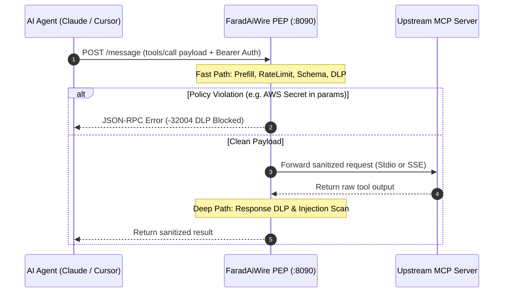

# AI Agent & IDE Integration 🤖

FaradAiWire sits as an inline Policy Enforcement Point (PEP) between your AI agent client and upstream Model Context Protocol (MCP) servers.



---

## Connection Endpoints & Authentication

All agent tool traffic must target FaradAiWire's **Proxy Ingress Port (8090)**:

| Parameter | Value | Notes |
| :--- | :--- | :--- |
| **Ingress Base URL** | `http://127.0.0.1:8090` | Never connect agents to Admin Port `8095` |
| **SSE Endpoint** | `http://127.0.0.1:8090/sse` | For persistent Server-Sent Events transports |
| **Message Endpoint** | `http://127.0.0.1:8090/message` | For standard HTTP POST JSON-RPC 2.0 frames |
| **Authorization Header** | `Authorization: Bearer <API_KEY>` | Matches `api_keys` in `config.yaml` or default dev key |

---

## 1. Claude Code CLI

Configure Claude Code to route all tool discovery and tool calls through FaradAiWire.

Edit `~/.claude.json` (or project-level `.claude.json`):

```json
{
  "mcpServers": {
    "faradaiwire-gateway": {
      "url": "http://127.0.0.1:8090/sse",
      "headers": {
        "Authorization": "Bearer dev-local-key",
        "X-Farad-Agent": "claude-code"
      }
    }
  }
}
```

Verify in Claude Code:
```bash
claude mcp list
```
*You will see `faradaiwire-gateway` listed as connected.*

---

## 2. Cursor IDE

Cursor supports remote MCP servers over HTTP/SSE.

Open **Cursor Settings** $\to$ **Features** $\to$ **MCP Servers**, or edit `.cursor/mcp.json` in your workspace root:

```json
{
  "mcpServers": {
    "faradaiwire": {
      "url": "http://127.0.0.1:8090/sse",
      "headers": {
        "Authorization": "Bearer dev-local-key",
        "X-Farad-Agent": "cursor-agent"
      }
    }
  }
}
```

Reload Cursor's MCP panel; a green indicator will confirm the connection to port 8090.

---

## 3. Claude Desktop App

Configure the Claude desktop application to use FaradAiWire as its secure proxy.

Open the configuration file:
- **macOS:** `~/Library/Application Support/Claude/claude_desktop_config.json`
- **Windows:** `%APPDATA%\Claude\claude_desktop_config.json`

Add the gateway entry:

```json
{
  "mcpServers": {
    "faradaiwire-pep": {
      "url": "http://127.0.0.1:8090/sse",
      "headers": {
        "Authorization": "Bearer dev-local-key",
        "X-Farad-Agent": "claude-desktop"
      }
    }
  }
}
```

Restart the Claude Desktop application.

---

## 4. Windsurf IDE

In Windsurf, open `~/.codeium/windsurf/mcp_config.json` and configure:

```json
{
  "mcpServers": {
    "faradaiwire": {
      "serverUrl": "http://127.0.0.1:8090/sse",
      "headers": {
        "Authorization": "Bearer dev-local-key",
        "X-Farad-Agent": "windsurf"
      }
    }
  }
}
```

---

## 5. Custom Python Agent (LangChain / LlamaIndex / Requests)

If you are building custom autonomous agents or LLM runners in Python, invoke MCP tools through FaradAiWire via HTTP POST:

```python
import requests

GATEWAY_URL = "http://127.0.0.1:8090/message"
API_KEY = "dev-local-key"

headers = {
    "Content-Type": "application/json",
    "Authorization": f"Bearer {API_KEY}",
    "X-Farad-Agent": "finance-analyst-agent",
    "X-User-Role": "Analyst"
}

payload = {
    "jsonrpc": "2.0",
    "id": "py-call-101",
    "method": "tools/call",
    "params": {
        "name": "query_db",
        "arguments": {
            "sql": "SELECT account_id, balance FROM accounts WHERE balance > 10000"
        }
    }
}

response = requests.post(GATEWAY_URL, json=payload, headers=headers)
data = response.json()

if "error" in data:
    print(f"Blocked by Policy: {data['error']['message']} (Code: {data['error']['code']})")
else:
    print("Sanitized Result:", data["result"])
```

---

## 6. Custom TypeScript / Node.js Agent

Using the official `@modelcontextprotocol/sdk`:

```typescript
import { Client } from "@modelcontextprotocol/sdk/client/index.js";
import { SSEClientTransport } from "@modelcontextprotocol/sdk/client/sse.js";

async function runSecureAgent() {
  const transport = new SSEClientTransport(
    new URL("http://127.0.0.1:8090/sse"),
    {
      eventSourceInit: {
        headers: {
          Authorization: "Bearer dev-local-key",
          "X-Farad-Agent": "ts-worker-agent",
        },
      },
      requestInit: {
        headers: {
          Authorization: "Bearer dev-local-key",
        },
      },
    }
  );

  const client = new Client({ name: "ts-agent", version: "1.0.0" }, { capabilities: {} });
  await client.connect(transport);

  // Invoke tool securely through FaradAiWire
  const result = await client.callTool({
    name: "read_file",
    arguments: { path: "package.json" },
  });

  console.log("Verified tool result:", result);
}

runSecureAgent().catch(console.error);
```

---

## Multi-Agent Domain Isolation Headers

When managing multiple agent roles on the same workstation or team cluster, FaradAiWire uses request headers to apply isolated policy profiles:

- `X-Farad-Agent`: Routes the call to an agent profile defined in `agents/<agent-name>.yaml`.
- `X-User-Role`: Evaluates role-based DLP and tool visibility policies (e.g. `Developer`, `Analyst`, `Admin`).
- `X-User-ID`: Attached to the DuckDB audit trail to maintain identity provenance.

---

## Verifying in the Web Console

Once your agent is configured and executes its first tool call:
1. Open **`http://localhost:8095/admin/dashboard`**.
2. Navigate to **Agent Studio** or **Live Audit Stream**.
3. Confirm that the incoming session is identified with the agent name (`claude-code`, `cursor-agent`, etc.), showing active tool schemas and security inspection verdicts in real-time.

