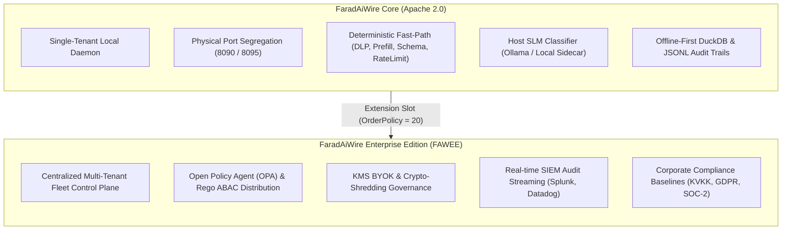

# Open Core Model & Enterprise Boundaries 🏢

FaradAiWire adheres strictly to the **Open Core Purity** model ([ADR-0022](../adr/0022-open-core-purity-uniform-plugin-pipeline-and-agent-handover.md) & [ADR-0050](../adr/0050-absolute-opa-purge-and-open-core-policy-decoupling.md)). We draw a distinct architectural boundary between the single-tenant open-source engine and the multi-tenant enterprise control plane.

---

## Comparison Matrix: Core vs. Enterprise

| Capability | FaradAiWire Core (Open Source) | FaradAiWireEE (Commercial) |
| :--- | :--- | :--- |
| **License** | **Apache 2.0** (Permissive Open Source) | Commercial Subscription |
| **Primary Identity** | Host-native workstation daemon (Single-Tenant) | Distributed cluster gateway & cloud SaaS |
| **Target Users** | Individual developers, AI researchers, teams | Enterprise security teams, CISOs, compliance officers |
| **Network Egress** | **Zero Egress:** 100% offline-first | Synchronizes policies with fleet control plane |
| **Authentication** | Bearer token / Local loopback auth | Enterprise SSO (SAML 2.0, OIDC, Okta, Azure AD) |
| **Authorization** | Regex DLP, schema pinning, HITL, SLM guard | **Open Policy Agent (OPA) & Rego** ABAC engine |
| **Policy Distribution**| Local `config.yaml` with fsnotify hot-reload | Centralized bundle compilation & instant fleet push |
| **Key Management** | Local keys in config / environment variables | **KMS BYOK** (AWS KMS, GCP KMS, HashiCorp Vault) |
| **Crypto-Shredding** | Not applicable (Local files) | Instant cryptographic key destruction for GDPR/KVKK |
| **Audit & Telemetry**| Embedded DuckDB & structured JSONL file | Real-time SIEM forwarding (Kafka, Splunk, Datadog) |
| **Compliance Packs** | Developer community patterns | Curated baselines (KVKK, GDPR, QCB, HIPAA, SOC-2) |

---

## ADR-0050: Absolute OPA Purge from Open Core

On October 29, 2026, [ADR-0050](../adr/0050-absolute-opa-purge-and-open-core-policy-decoupling.md) completed the formal decoupling of Open Policy Agent (OPA) from FaradAiWire Core:

1. **Protocol Generalization:** The JSON-RPC error code `-32003` was generalized from `ErrOPAPolicyDenied` to `mcp.ErrPolicyDenied` ("Policy authorization denied").
2. **Clean Pipeline Extension Point:** The constant `OrderOPA = 20` was replaced with `OrderPolicy = 20`. This reserves a vendor-neutral hook where enterprise distributions or custom policy engines can inject authorization logic without polluting the open-source codebase.
3. **Zero Phantom Artifacts:** FaradAiWire Core contains zero references to OPA, Rego, or remote SaaS control plane APIs.

---

## When Should You Use Which?

### Choose FaradAiWire Core If:
- You are an individual engineer or small team running AI coding agents (Claude Code, Cursor, Windsurf) on local workstations.
- You need microsecond-level DLP protection against leaked credentials or sensitive files.
- You require 100% offline privacy where no telemetry leaves your computer.
- You want a lightweight daemon you can install in 10 seconds via Homebrew or shell script.

### Choose FaradAiWireEE If:
- Your organization enforces centralized attribute-based access control (ABAC) using OPA across hundreds of developer workstations.
- You must stream audit logs in real-time to an enterprise SIEM for compliance audits.
- You need cryptographic proof of data deletion (**Crypto-Shredding**) to comply with KVKK or GDPR regulations.
- You require corporate SSO, role-based access control, and centralized key management.

To learn more about enterprise capabilities, see the [FaradAiWireEE Documentation](/docs/wire-ee/).

