# Open Core Model & Enterprise Boundaries 🏢

FaradAiWire adheres strictly to the **Open Core Purity** model. We draw a distinct architectural boundary between the single-tenant open-source engine and the multi-tenant enterprise control plane.

```mermaid
graph TD
    subgraph OpenCore ["FaradAiWire Core (Apache 2.0)"]
        direction TB
        C1["Single-Tenant Local Daemon"]
        C2["Physical Port Segregation (19410 / 19415)"]
        C3["Deterministic Fast-Path (DLP, Prefill, Schema, RateLimit)"]
        C4["Host AI Guard Engine (Ollama / FaradAiGuard Sidecar)"]
        C5["Offline-First DuckDB & JSONL Audit Trails"]
    end

    subgraph Enterprise ["FaradAiWire Enterprise Edition (FAWEE)"]
        direction TB
        E1["Centralized Multi-Tenant Fleet Control Plane"]
        E2["Open Policy Agent (OPA) & Rego ABAC Distribution"]
        E3["KMS BYOK & Crypto-Shredding Governance"]
        E4["Real-time SIEM Audit Streaming (Splunk, Datadog)"]
        E5["Corporate Compliance Baselines (KVKK, GDPR, SOC-2)"]
    end
```

---

## Comparison Matrix: Core vs. Enterprise

| Capability | FaradAiWire Core (Open Source) | FaradAiWireEE (Commercial) |
| :--- | :--- | :--- |
| **License** | **Apache 2.0** (Permissive Open Source) | Commercial Subscription |
| **Primary Identity** | Host-native workstation daemon (Single-Tenant) | Distributed cluster gateway (Multi-Tenant) |
| **Target Users** | Individual developers, AI researchers, teams | Enterprise security teams, CISOs, compliance officers |
| **Network Egress** | **Zero Egress:** 100% offline-first | Synchronizes policies with fleet control plane |
| **Authentication** | Bearer token / Local loopback auth | Enterprise SSO (SAML 2.0, OIDC, Okta, Azure AD) |
| **Authorization** | Regex DLP, schema pinning, HITL, AI Guard | **Open Policy Agent (OPA) & Rego** ABAC engine |
| **Policy Distribution**| Local `config.yaml` with fsnotify hot-reload | Centralized bundle compilation & instant fleet push |
| **Key Management** | Local keys in config / environment variables | **KMS BYOK** (AWS KMS, GCP KMS, HashiCorp Vault) |
| **Crypto-Shredding** | Not applicable (Local files) | Instant cryptographic key destruction for GDPR/KVKK |
| **Audit & Telemetry**| Embedded DuckDB & structured JSONL file | Real-time SIEM forwarding (Kafka, Splunk, Datadog) |
| **Compliance Packs** | Developer community patterns | Curated baselines (KVKK, GDPR, QCB, HIPAA, SOC-2) |

---

## Standalone Policy Architecture

FaradAiWire Core is designed as a self-contained, offline-first security gateway:

1. **Standardized Policy Errors:** Policy denials return the JSON-RPC error code `-32003` (`mcp.ErrPolicyDenied`, `"Policy authorization denied"`).
2. **Vendor-Neutral Extension Point:** The pipeline reserves `OrderPolicy = 20` as a clean hook for custom policy engines without coupling Core to external services.
3. **Zero External Dependencies:** FaradAiWire Core operates completely offline with no external control-plane dependencies or outbound telemetry.

---

## When Should You Use Which?

### Choose FaradAiWire Core If:
- You are an individual engineer or small team running AI coding agents (Claude Code, Cursor, Windsurf) on local workstations.
- You need microsecond-level DLP protection against leaked credentials or sensitive files.
- You require 100% offline privacy where no telemetry leaves your computer.
- You want a lightweight daemon you can install in 10 seconds via Homebrew or shell script.

### Choose FaradAiWireEE If:
- Your organization enforces centralized attribute-based access control (ABAC) using OPA across hundreds of developer workstations.
- You must stream audit logs in real-time to an enterprise SIEM for compliance audits.
- You need cryptographic proof of data deletion (**Crypto-Shredding**) to comply with KVKK or GDPR regulations.
- You require corporate SSO, role-based access control, and centralized key management.

To learn more about enterprise capabilities, see the [FaradAiWireEE Documentation](/docs/wire-ee/).

