# System Architecture 🏗️

FaradAiWire operates as a high-throughput, single-tenant Policy Enforcement Point (PEP) mediating all interactions between client AI agents and Model Context Protocol (MCP) tool execution engines.

```mermaid
graph TD
    subgraph Client Layer
        Agent["AI Agent / IDE Client\n(Claude Code, Cursor, Copilot)"]
    end

    subgraph FaradAiWire PEP [Host-Native Daemon]
        subgraph PortSegregation [Physical Port Segregation]
            P1["Port 8090: Ingress Proxy\n(Fail-Closed Bearer Auth)"]
            P2["Port 8095: Admin Console\n(Loopback REST & Embedded UI)"]
        end

        subgraph CoreEngine [Core Security Engine]
            Router["Adaptive Fast/Deep Path Router"]
            
            subgraph FastPath ["Fast Path (<1ms)"]
                F_Prefill["Assistant Prefill Guard"]
                F_Rate["Token-Bucket Rate Limiter"]
                F_Loop["Loop Protection (max_repeat)"]
                F_Schema["Runtime Schema Validation & Pinning"]
                F_DLP["Deterministic DLP Engine (Mask / Block)"]
            end
            
            subgraph DeepPath ["Deep Path (15-40ms)"]
                D_SLM["Local SLM Prompt Guard\n(Ollama / Docker / Unix Socket)"]
                D_HITL["Human-in-the-Loop Interceptor\n(TTY Prompt or Webhook)"]
            end

            Telemetry["Embedded DuckDB Analytics & Structured JSONL Audit"]
        end
    end

    subgraph UpstreamMCP [Upstream Tool Targets]
        RemoteMCP["Remote MCP Servers\n(SSRF-Protected HTTP/SSE Dial)"]
        StdioMCP["Local MCP Subprocesses\n(Sanitized Process Group Stdio)"]
    end

    Agent -->|"JSON-RPC 2.0 / Bearer"| P1
    Operator["Security Admin"] -->|"Dashboard / API"| P2
    P1 --> Router
    Router --> FastPath
    Router -.->|"High-Risk / Semantic Scan"| DeepPath
    FastPath --> UpstreamMCP
    DeepPath --> UpstreamMCP
    FastPath -.->|"Tamper-Evident Verdict"| Telemetry
    DeepPath -.->|"Tamper-Evident Verdict"| Telemetry
```



---

## Architectural Pillars

### 1. Zero-Trust Ingress Security
Every frame passing through Port 8090 must present valid Bearer authentication. Unauthenticated requests are rejected immediately with HTTP 401 before any JSON parsing or downstream processing occurs.

### 2. Fast Path vs. Deep Path Adaptive Routing
To maintain $<1\text{ ms}$ average latency overhead across high-frequency agent tool calls (e.g. `read_file`, `list_directory`), FaradAiWire implements an adaptive router:
- **Fast Path:** Deterministic, in-memory filters executing compiled regexes, token-bucket math, and JSON schema checks in $<1\text{ ms}$.
- **Deep Path:** Activated for sensitive tools, untrusted web outputs, or ambiguous arguments. Hands off payloads to local SLM classifiers (e.g., `llama-guard3:1b` or `qwen3guard-0.6b`) or pauses execution for Human-In-The-Loop approval.

### 3. Hexagonal Proxy Layering & Zero-IO Core
The core security engine is decoupled from HTTP, SSE, and Stdio transport details:
- **Transport Adapters:** Handle frame serialization, SSE keep-alives, and process piping.
- **Filter Pipeline Interface:** Receives canonical in-memory message structs (`pkg/mcp.Message`), ensuring filters can be tested deterministically with zero network I/O.
- **Upstream Dispatcher:** Dispatches approved calls to remote servers via SSRF-safe HTTP clients or local subprocesses with OS-level process group isolation (`syscall.Setpgid`).

---

## Filter Pipeline Execution Hierarchy

Filters execute in strict order defined by `OrderPolicy` precedence constants:

```
[Ingress Frame]
      │
      ▼
1. Assistant Prefill Guard  (Order: 5)   ── Blocks conversational hijacking
      │
      ▼
2. Token-Bucket Rate Limit  (Order: 10)  ── Protects downstream API quotas
      │
      ▼
3. Loop Protection          (Order: 15)  ── Halts repeated identical tool calls
      │
      ▼
4. Extension / Policy Hook  (Order: 20)  ── Enterprise or custom rules
      │
      ▼
5. JSON Schema Validation   (Order: 30)  ── Validates arguments; tracks schema changes
      │
      ▼
6. DLP Pattern Matcher      (Order: 50)  ── Masks or blocks credentials/PII
      │
      ▼
7. Semantic SLM Guard       (Order: 55)  ── Neural classifier (injection/jailbreak)
      │
      ▼
8. Human-in-the-Loop        (Order: 70)  ── Suspends destructive tool executions
      │
      ▼
[Upstream MCP Tool Dispatch]
```

Any filter returning a terminal error (`*mcp.Error`) immediately aborts pipeline traversal, writes a structured audit event to DuckDB/JSONL, and returns a JSON-RPC error frame to the client.

---

## Memory & Concurrency Design (Go 1.23+)

FaradAiWire is engineered in Go for minimal footprint and extreme concurrency:
- **Zero-Allocation Hot Path:** Payload inspection reuses `sync.Pool` byte buffers and zero-copy byte slices to achieve sub-millisecond P99 response times.
- **Context Propagation:** All filters and upstream dials honor `context.Context` cancellation and deadline timeouts. When an agent client disconnects, running subprocesses and inference HTTP calls terminate immediately without leaking goroutines.
- **Atomic Pipeline Swapping:** Hot-reloading (`config.yaml`) updates use atomic pointers (`sync/atomic`), ensuring in-flight requests complete against the existing configuration while new requests immediately use the reloaded rules.
- **Embedded DuckDB Analytics:** Telemetry is batched in an in-memory queue and committed to DuckDB in background worker goroutines, decoupling database write latency from request processing.

