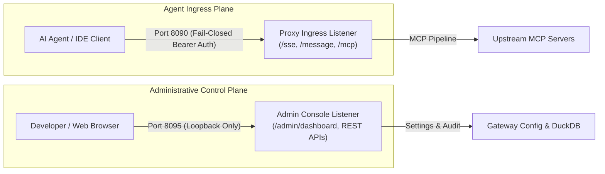

# Strict Physical Port Segregation 🔌

A core security invariant of FaradAiWire is **Physical Port Segregation** ([ADR-0021](../adr/0021-fail-closed-ingress-strict-port-segregation-and-upstream-hygiene.md) & [ADR-0025](../adr/0025-canonical-port-standardization-and-809x-block-alignment.md)). FaradAiWire refuses to multiplex administrative management endpoints and untrusted agent proxy traffic onto a single port.



---

## Why Physical Port Segregation?

Many traditional API proxies multiplex administrative routes (`/admin`, `/metrics`, `/debug/pprof`) and application traffic on the same HTTP port, relying on path-based routing rules. In an AI agent environment, this introduces critical vulnerabilities:

1. **Path Normalization Bypasses:** Ambiguous URL encodings (`/admin/..;/message` or `%2fadmin`) in agent tools or malicious LLM payloads can inadvertently expose internal admin APIs.
2. **Reverse Proxy & Ingress Leaks:** Misconfigured upstream reverse proxies (e.g. Nginx, Cloudflare Tunnels) can inadvertently expose the entire port to external networks, allowing attackers to access internal admin controls.
3. **Privilege Escalation:** By maintaining two separate HTTP listeners in Go with distinct multiplexers (`http.ServeMux`), administrative routes literally do not exist on the Ingress port. A request to `http://127.0.0.1:8090/admin/settings` yields an immediate `404 Not Found` at the network socket layer.

---

## Port Specification & Behavioral Comparison

| Dimension | Port 8090: Proxy Ingress | Port 8095: Admin Console |
| :--- | :--- | :--- |
| **Primary Consumer** | AI Agents (Claude Code, Cursor, SDKs) | Developers, Security Engineers, Browsers |
| **Default Binding** | `127.0.0.1:8090` | `127.0.0.1:8095` (Strict Loopback) |
| **Authentication** | Fail-Closed (`Authorization: Bearer <key>`) | Loopback Standalone or `X-API-Key` |
| **Primary Endpoints** | `/sse`, `/message`, `/mcp` | `/admin/dashboard`, `/admin/status`, REST APIs |
| **Payload Protocols** | JSON-RPC 2.0 over SSE & HTTP POST | HTML/React UI, JSON REST responses |
| **Security Pipeline** | Full Inspection Pipeline (Prefill, DLP, SLM) | Direct Administrative Handlers |
| **Public Exposure Safe?** | Yes (behind reverse proxy with Bearer Auth) | **NO** (Must stay on internal/loopback network) |

---

## Port 8090: Proxy Ingress Details

The Proxy Ingress listener handles high-volume JSON-RPC 2.0 streaming.
- **Fail-Closed Enforcement:** If no API key or Bearer token is provided, the connection is terminated immediately with HTTP 401.
- **Dual Transport:**
  - `GET /sse`: Establishes persistent Server-Sent Events stream for agent clients.
  - `POST /message`: Ingests JSON-RPC 2.0 frames (`tools/call`, `tools/list`).
  - `POST /mcp`: Direct single-frame proxying endpoint.
- **Timeout & Deadlines:** Enforces strict read/write timeouts to prevent slowloris attacks from compromised agent plugins.

---

## Port 8095: Admin Console Details

The Admin Console listener hosts the embedded developer dashboard and system configuration APIs.
- **Loopback Binding ([ADR-0028](../adr/0028-open-core-admin-auth-purge-and-strict-loopback-isolation.md)):** By default, Port 8095 strictly binds to `127.0.0.1`. In container environments, access is guarded via `API_KEY` or `X-API-Key` header.
- **Capabilities:**
  - **Embedded Web Console (`/admin/dashboard`):** Real-time threat visualizer, audit log stream, and agent studio.
  - **Health & Status (`/admin/status`):** Subsystem health, active connections, and DuckDB row counts.
  - **Runtime Toggles (`/admin/config/toggle`):** Dynamically enable/disable DLP rules or SLM inference without restarting the daemon.
  - **Tool Catalog (`/admin/mcp/tools`):** Inspect discovered MCP tools and cached JSON schemas.

---

## Configuration

Ports can be customized in `config.yaml` or overridden via CLI flags and environment variables:

```yaml
# config.yaml
listen_port: 8090    # Agent Ingress Proxy
admin_port: 8095     # Admin Console & UI
```

### CLI Overrides:
```bash
faradaiwire run --port 8090 --admin-port 8095
```

### Environment Overrides:
```bash
export FARADAI_WIRE_HOST="127.0.0.1"
export LISTEN_PORT=8090
export ADMIN_PORT=8095
```

