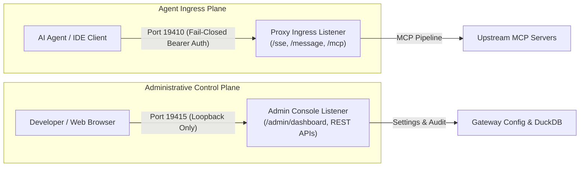

# Strict Physical Port Segregation 🔌

A core security invariant of FaradAiWire is **Physical Port Segregation**. FaradAiWire refuses to multiplex administrative management endpoints and untrusted agent proxy traffic onto a single port.



---

## Why Physical Port Segregation?

Many traditional API proxies multiplex administrative routes (`/admin`, `/metrics`, `/debug/pprof`) and application traffic on the same HTTP port, relying on path-based routing rules. In an AI agent environment, this introduces critical vulnerabilities:

1. **Path Normalization Bypasses:** Ambiguous URL encodings (`/admin/..;/message` or `%2fadmin`) in agent tools or malicious LLM payloads can inadvertently expose internal admin APIs.
2. **Reverse Proxy & Ingress Leaks:** Misconfigured upstream reverse proxies (e.g. Nginx, Cloudflare Tunnels) can inadvertently expose the entire port to external networks, allowing attackers to access internal admin controls.
3. **Privilege Escalation:** By maintaining two separate HTTP listeners in Go with distinct multiplexers (`http.ServeMux`), administrative routes literally do not exist on the Ingress port. A request to `http://127.0.0.1:19410/admin/settings` yields an immediate `404 Not Found` at the network socket layer.

---

## Port Specification & Behavioral Comparison

| Dimension | Port 19410: Proxy Ingress | Port 19415: Admin Console |
| :--- | :--- | :--- |
| **Primary Consumer** | AI Agents (Claude Code, Cursor, SDKs) | Developers, Security Engineers, Browsers |
| **Default Binding** | `127.0.0.1:19410` | `127.0.0.1:19415` (Strict Loopback) |
| **Authentication** | Fail-Closed (`Agent` key via `Authorization: Bearer` / `X-API-Key`; `Admin` keys rejected with `403 INGRESS_ROLE_REQUIRED`) | Loopback Standalone or `Admin` key in `keys/api_keys.json` (`faradaiwire token [--rotate]`; `Agent` keys rejected with `403 ADMIN_ROLE_REQUIRED`) |
| **Primary Endpoints** | `/sse`, `/message`, `/mcp` | `/admin/dashboard`, `/admin/status`, REST APIs |
| **Payload Protocols** | JSON-RPC 2.0 over SSE & HTTP POST | HTML/React UI, JSON REST responses |
| **Security Pipeline** | Full Inspection Pipeline (Prefill, DLP, AI Guard) | Direct Administrative Handlers |
| **Public Exposure Safe?** | Yes (behind reverse proxy with Bearer Auth) | **NO** (Must stay on internal/loopback network) |

---

## Port 19410: Proxy Ingress Details

The Proxy Ingress listener handles high-volume JSON-RPC 2.0 streaming.
- **Fail-Closed Enforcement:** If no API key or Bearer token is provided, the connection is terminated immediately with HTTP 401.
- **Dual Transport:**
  - `GET /sse`: Establishes persistent Server-Sent Events stream for agent clients.
  - `POST /message`: Ingests JSON-RPC 2.0 frames (`tools/call`, `tools/list`).
  - `POST /mcp`: Direct single-frame proxying endpoint.
- **Timeout & Deadlines:** Enforces strict read/write timeouts to prevent slowloris attacks from compromised agent plugins.

---

## Port 19415: Admin Console Details

The Admin Console listener hosts the embedded developer dashboard and system configuration APIs.
- **Loopback Binding & Single KeyStore Admin Source:** By default, Port 19415 strictly binds to `127.0.0.1` (`admin_host` / `--admin-host` / `FARADAI_WIRE_ADMIN_HOST`). Binding the Admin Console to a non-loopback address fails closed at startup unless an active `Admin` key (`Bootstrap Master Key`) exists in `keys/api_keys.json` (`faradaiwire token [--rotate]`), in which case protected Admin APIs require an `Admin` Bearer token or `HttpOnly` session cookie. Even on loopback, sending an explicit `Authorization: Bearer <AgentKey>` returns `403 ADMIN_ROLE_REQUIRED`.
- **Browser CSRF & CSWSH Isolation:** Admin routes and WebSocket upgrades validate `Sec-Fetch-Site`, `Origin`, and `Content-Type: application/json` (on mutations). Setting `security.cors_allowed_origins: ["*"]` does not bypass Origin/CSRF or WebSocket Origin checks.
- **Capabilities:**
  - **Embedded Web Console (`/admin/dashboard`):** Real-time threat visualizer, audit log stream, and agent studio.
  - **Health & Status (`/admin/status`):** Subsystem health, active connections, and DuckDB row counts.
  - **Runtime Toggles (`/admin/config/toggle`):** Dynamically enable/disable DLP rules or AI Guard inference without restarting the daemon.
  - **Tool Catalog (`/admin/mcp/tools`):** Inspect discovered MCP tools and cached JSON schemas.

---

## Configuration

Ports can be customized in `config.yaml` or overridden via CLI flags and environment variables:

```yaml
# config.yaml
listen_port: 19410   # Agent Ingress Proxy
admin_port: 19415    # Admin Console & UI
```

### CLI Overrides:
```bash
faradaiwire run --port 19410 --admin-port 19415
```

### Environment Overrides:
```bash
export FARADAI_WIRE_HOST="127.0.0.1"
export LISTEN_PORT=19410
export ADMIN_PORT=19415
```

