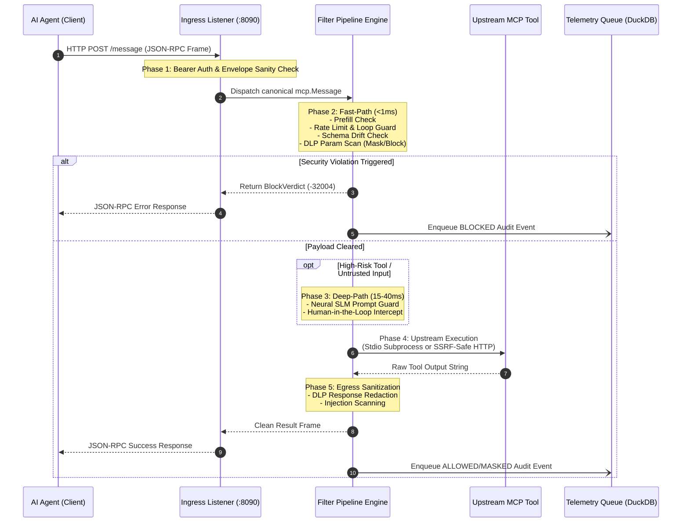

# Request Lifecycle & Frame Dispatch 🔄

This document traces the complete execution lifecycle of an MCP tool call (`tools/call`) as it travels through FaradAiWire's ingress socket, security filters, upstream transport, and audit engine.

---

## Phase 1: Ingress Authentication & Envelope Validation

1. **Physical Listener:** The frame is received on Port 8090 via `POST /message`, `POST /mcp`, or streamed over `GET /sse`.
2. **Bearer Token Validation:** The HTTP `Authorization` header is verified against the gateway's authorized keys. If missing or invalid, the connection is rejected immediately with HTTP 401 Unauthorized.
3. **JSON-RPC 2.0 Syntax Validation:** The body is parsed using Go's streaming decoder into a canonical `pkg/mcp.Message`:
   - Validates that `"jsonrpc": "2.0"` is present.
   - Ensures `"id"` is a non-empty string or integer.
   - Validates `"method"` (e.g. `tools/call`, `tools/list`, `initialize`).

---

## Phase 2: Agent Identification & Context Provenance

FaradAiWire extracts identity metadata from incoming HTTP headers:
- `X-Farad-Agent`: Identifies the client persona (e.g., `code-reviewer`, `db-analyst`). If omitted, falls back to `default`.
- `X-User-Role`: Resolves the human or system role (e.g., `Developer`, `Customer`).
- `X-User-ID`: Identifies the human operator for audit trails.
- **Context Anti-Spoofing:** If `FARADAI_WIRE_HMAC_SECRET` is configured, FaradAiWire validates the cryptographic signature of the role header to prevent untrusted agents from forging their own privilege levels.

---

## Phase 3: Fast-Path Filter Pipeline ($<1\text{ ms}$)

The message travels through the ordered in-memory filter chain:

1. **Assistant Prefill Guard (`Order: 10`):** Checks for conversational sockpuppeting and LLM prefill exploitation payloads.
2. **Rate Limiting (`Order: 30`):** Checks the client's token-bucket. If burst capacity is exhausted, returns JSON-RPC error `-32000` (Rate limit exceeded).
3. **Loop Protection (`Order: 35`):** Tracks the sliding-window fingerprint (`tool_name + args_hash`). If the exact same call repeats consecutively $\ge \text{max\_repeat}$ times, execution aborts with error `-32002` (Infinite loop detected).
4. **JSON Schema Validation (`Order: 50`):** Validates argument types against cached tool schemas. If dynamic capture is active, detects baseline drift (tool poisoning).
5. **DLP Pattern Matching (`Order: 60`):** Executes high-performance compiled regexes across all parameter string fields:
   - If a pattern is configured with `action: block`, execution terminates with `-32004`.
   - If configured with `action: mask`, the sensitive substring is replaced with a semantic placeholder (e.g. `[REDACTED:API_KEY]`).

---

## Phase 4: Deep-Path Adaptive Branching (15–40 ms)

If the tool is categorized as high-risk or external input inspection is required:
- **Neural SLM Prompt Guard (`Order: 70`):** Sends the tool name and argument text to a local inference engine (Ollama `llama-guard3:1b` or Docker sidecar `prompt-guard`). If the classifier marks the content as unsafe with confidence exceeding threshold (default 0.85), the request is blocked.
- **Human-In-The-Loop (HITL) Interceptor (`Order: 80`):** If the tool is listed under `destructive_tools` (e.g. `write_to_db`, `send_email`), FaradAiWire pauses the HTTP connection and triggers an operator approval prompt (via CLI interactive terminal or webhook). If rejected or timed out, returns `-32005` (Action rejected by human operator).

---

## Phase 5: Upstream Tool Execution

Once cleared, the request is dispatched to the upstream tool provider based on configured session transport:
- **Local Subprocess (`stdio`):** Spawns or pipes to the local process (e.g. `npx -y @modelcontextprotocol/server-postgres`). The process runs with isolated process group credentials (`syscall.Setpgid`) and filtered environment variables to prevent host credential leaks.
- **Remote MCP Server (`http/sse`):** Dials the remote URL using FaradAiWire's SSRF-safe HTTP transport, blocking loopback and private RFC 1918 IPs unless explicitly whitelisted via `FARADAI_WIRE_ALLOW_LOCAL_TARGETS=true`.

---

## Phase 6: Egress Result Sanitization

The upstream tool's output is inspected before reaching the AI agent:
1. **DLP Response Scanning:** Scans tool output (e.g. file contents, database rows) for sensitive credentials and PII. Masks data in-place to prevent leaking secrets into the agent's context window.
2. **Indirect Injection Scan:** Neutralizes hidden prompt injections embedded within scraped web pages or PDF documents.

---

## Phase 7: Non-Blocking Telemetry & Verdict Recording

Before completing the HTTP response:
1. A **Telemetry Verdict** (`ALLOWED`, `MASKED`, `BLOCKED`, `CRITICAL`) is generated.
2. The verdict, duration, rule IDs, and metadata are pushed to an asynchronous ring buffer channel.
3. Dedicated worker goroutines commit the entry to `logs/faradai_audit.jsonl` and the embedded DuckDB database (`~/.faradaiwire/telemetry.duckdb`).
4. The client receives the sanitized JSON-RPC response with zero observable logging latency.

