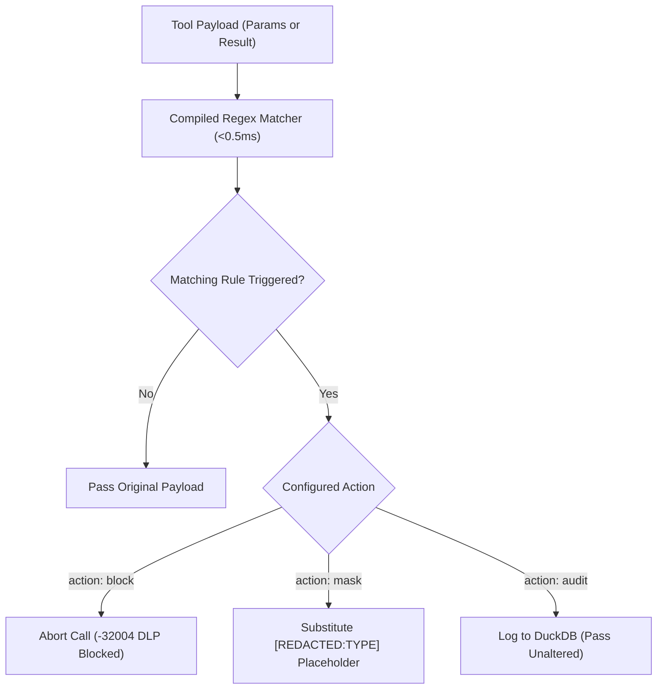

# Data Loss Prevention (DLP) 🔒

FaradAiWire's **Data Loss Prevention (DLP) Engine** ([ADR-0033](../adr/0033-semantic-dlp-audit-action-and-telemetry-diff.md) & [ADR-0035](../adr/0035-directional-agent-tool-dlp-and-scope-governance.md)) inspects both incoming tool call parameters and outgoing tool execution results to prevent sensitive data leakage.

Executing pre-compiled regular expressions in $<0.5\text{ ms}$, the DLP engine protects credentials, SSH keys, configuration secrets, and Personally Identifiable Information (PII) from being leaked into third-party LLM context windows.



---

## The Three Policy Actions

| Action | Execution Impact | Response to Agent | Use Case |
| :--- | :--- | :--- | :--- |
| **`block`** | **Terminating** | JSON-RPC Error `-32004` | High-risk credentials (private keys, `/etc/shadow`, `.env` files). |
| **`mask`** | **Mutating** | Rewrites string to `[REDACTED:<NAME>]` | Customer PII (credit cards, emails, TC Kimlik) where the agent needs semantic context. |
| **`audit`** | **Observing** | Passes original string unaltered | Monitor mode / testing new regex patterns before enforcing. |

---

## Semantic Redaction Placeholders

When a rule is configured with `action: mask`, FaradAiWire avoids crude blanking or deletion. Instead, it replaces the matching text with a **Semantic Redaction Placeholder**:

- Raw input: `"Please charge 500 USD to 4532-1234-5678-9010"`
- Sanitized payload: `"Please charge 500 USD to [REDACTED:CREDIT_CARD]"`

**Why Semantic Placeholders?**
Standard redaction (e.g. `***` or empty strings) confuses downstream LLM reasoning and triggers hallucinated retries. A semantic placeholder preserves grammatical structure and semantic category, allowing the agent to continue its task without exposing secret values.

---

## Built-In Detection Patterns

The standard `config.yaml` provides verified, high-performance patterns:

```yaml
filters:
  dlp:
    enabled: true
    exclude_tools: []           # Tools exempt from inspection (e.g. specialized crypto tools)
    patterns:
      - name: "private_keys"
        regex: '-----BEGIN (RSA|EC|OPENSSH|DSA|PGP) PRIVATE KEY-----'
        action: "block"

      - name: "sensitive_files"
        regex: '(?i)(\.env|\.aws/credentials|id_rsa|id_ed25519|/etc/shadow|/etc/passwd)'
        action: "block"

      - name: "aws_credentials"
        regex: '(?i)["'']?(aws_secret_access_key|aws_access_key_id)["'']?\s*[:=]?\s*["'']?[A-Za-z0-9/+=]{16,}["'']?'
        action: "mask"

      - name: "credit_card"
        regex: '\b\d{4}[\s-]?\d{4}[\s-]?\d{4}[\s-]?\d{4}\b'
        action: "mask"

      - name: "email"
        regex: '\b[A-Za-z0-9._%+-]+@[A-Za-z0-9.-]+\.[A-Z]{2,}\b'
        action: "mask"

      - name: "tc_kimlik"
        regex: '\b\d{11}\b'
        action: "mask"
```

---

## Bi-Directional Inspection (Ingress & Egress)

1. **Ingress Parameter Scanning:** When an agent invokes `tools/call`, arguments are scanned. If a developer prompt causes an agent to pass an AWS Secret Key to a web tool, FaradAiWire blocks the request before it leaves the machine.
2. **Egress Result Scanning:** When an upstream tool returns data (e.g. reading a log file or executing a database query), FaradAiWire scans the output text before returning it to the agent. If the file contains database passwords or customer PII, FaradAiWire redacts the data in-place so it never enters the LLM's prompt context.

---

## Adding Custom Enterprise Patterns

Add custom regex patterns directly to `config.yaml`:

```yaml
      - name: "internal_api_tokens"
        regex: 'farad_[a-zA-Z0-9]{32}'
        action: "block"

      - name: "customer_iban"
        regex: 'TR\d{2}[0-9A-Z]{5}\d{17}'
        action: "mask"
```

*Patterns take effect instantly at runtime without restarting the daemon.*

