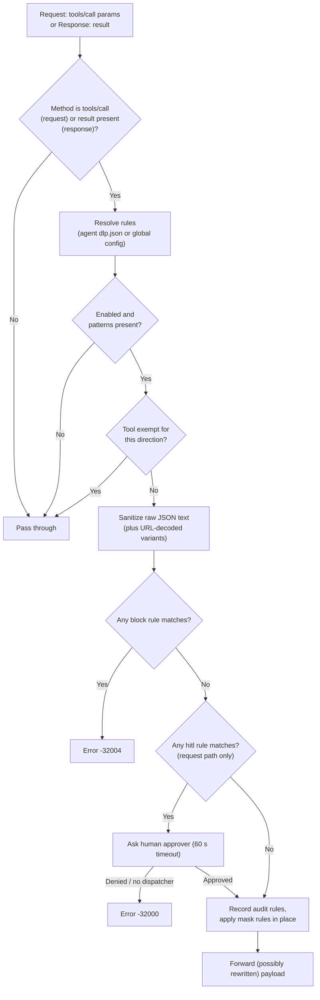

# Data Loss Prevention (DLP)

The `dlp` filter scans MCP traffic with regular expressions and then blocks, masks, audits, or escalates to a human whenever a pattern matches. Source: `internal/filter/dlp/` (`dlp.go`, `sanitizer.go`, `provider.go`, `types.go`).

## 1. What it does

It stops two kinds of leakage:

- **Outbound leakage (request path):** an agent, usually steered by a prompt or by injected content, passes a secret (private key, cloud credential, `.env` path, customer PII) as an argument to a tool.
- **Inbound leakage (response path):** a tool returns secrets or PII (a log file, a database row, a config dump) that would otherwise enter the LLM context window.

Matching is done with Go `regexp` (RE2). Patterns are compiled once, not per request.

## 2. How it works



Verified behavior of `Sanitize` (`sanitizer.go`), applied in this order:

1. **Canonicalization.** If the payload contains `%`, extra variants are produced with path-unescape (up to 2 passes) and query-unescape (up to 2 passes). If there is no `%`, only the original string is scanned.
2. **Pass 1, block.** Any `block` pattern matching any variant aborts immediately. Block always wins over other actions.
3. **Pass 1.5, hitl.** Any `hitl` pattern matching any variant requests human approval.
4. **Pass 2, audit.** `audit` matches are collected by rule name (de-duplicated) and written into the request's audit metadata. The payload is not changed.
5. **Pass 3, mask.** Every pattern whose action is not `block`, `hitl`, or `audit` is applied with `ReplaceAllString` on the original payload, in pattern order. The replacement is the pattern's `placeholder` if set, otherwise `[REDACTED:<NAME>]` where the name is upper-cased and non-alphanumerics become `_` (for example `credit_card` becomes `[REDACTED:CREDIT_CARD]`). If the name normalizes to empty, `[REDACTED]` is used.

Actions:

| Action | Effect | Request path | Response path |
| :--- | :--- | :--- | :--- |
| `block` | Aborts the call | Yes | Yes |
| `hitl` | Human approval before execution | Yes | Not handled (see caveats) |
| `mask` | Replaces matches with a placeholder | Yes | Yes |
| `audit` | Logs the rule name, payload unchanged | Yes | Yes |

An empty `action` is treated as `mask`.

## 3. Pipeline order and scope

- **Order:** `OrderDLP = 50` (`pkg/filter/filter.go`). It runs after schema validation (30) and before the guard (55).
- **Paths:** both request and response (`RequestFilter` and `ResponseFilter`).
- **Request scope:** only `tools/call` requests with non-empty `params`. The whole `params` JSON is scanned, including the tool name and argument keys, not just argument values.
- **Response scope:** any response with a non-nil `result`, regardless of method.
- **Enablement:** the filter is only built when `filters.dlp.enabled` is `true` (`internal/filter/builder.go`).

## 4. Configuration

All values below are configurable. Nothing is hard-coded except the fallback behaviors listed.

```yaml
filters:
  dlp:
    enabled: true                    # default in generated config: true
    exclude_tools: []                # default: empty
    debug_retain_unmasked_diff: false  # default: false (Go zero value)
    patterns:                        # if empty, built-in baseline (3 rules) is used
      - name: "private_keys"
        regex: '-----BEGIN (RSA|EC|OPENSSH|DSA|PGP) PRIVATE KEY-----'
        action: "block"
      - name: "sensitive_files"
        regex: '(?i)(\.env|\.aws/credentials|id_rsa|id_ed25519|/etc/shadow|/etc/passwd)'
        action: "block"
      - name: "aws_credentials"
        regex: '(?i)["'']?(aws_secret_access_key|aws_access_key_id)["'']?\s*[:=]?\s*["'']?[A-Za-z0-9/+=]{16,}["'']?'
        action: "mask"
        placeholder: "[REDACTED:AWS]"   # optional
```

| Field | Type | Default | Meaning |
| :--- | :--- | :--- | :--- |
| `enabled` | bool | `true` in the generated default config | Turns the filter on. |
| `exclude_tools` | list of strings | `[]` | Tool names exempt from DLP in both directions (exact match). |
| `patterns[].name` | string | none | Rule identifier, used in error messages, audit records, and the default placeholder. |
| `patterns[].regex` | string | none | Go RE2 regex. An invalid regex makes the filter fail to build, so startup or reload fails. |
| `patterns[].action` | string | `mask` when empty | `mask`, `block`, `audit`, or `hitl`. |
| `patterns[].placeholder` | string | `[REDACTED:<NAME>]` | Optional custom replacement text for `mask`. |
| `debug_retain_unmasked_diff` | bool | `false` | Debug flag passed to the pipeline (`SetDebugRetainUnmaskedDiff`) to keep the unmasked diff in telemetry. Do not enable in production. |

Defaults and fallbacks:

- If `patterns` is empty, `DefaultBaselinePatterns()` is used: `private_keys` (block), `sensitive_files` (block), `aws_credentials` (mask).
- The generated default config written by `internal/config/provider.go` includes `private_keys`, `sensitive_files` (block), `aws_credentials`, `email`, `credit_card` (mask). The repo's `config.yaml` sets `sensitive_files` to `mask`. Check your own file.

### Per-agent overrides and policy packs

Supported in code:

- **Per-agent `dlp.json`.** The provider looks up `<agentsDir>/<agent>/current/dlp.json`, then `<agentsDir>/<agent>/dlp.json`, then the same two layouts under `/etc/faradaiwire/agents` and `./agents`. If found and valid, it fully replaces the global patterns, exemptions, and enabled flag for that agent (no merge). `"enabled": false` disables DLP for that agent.

  ```json
  {
    "enabled": true,
    "patterns": [{ "name": "iban", "regex": "TR\\d{24}", "action": "mask" }],
    "custom_patterns": [],
    "tool_exemptions": { "read_log": { "request": false, "response": true } }
  }
  ```

  `tool_exemptions` is directional, unlike the global `exclude_tools`. The agent name is taken from the request context.
- **Policy packs.** `internal/policy` compiles an agent's attached packs, overrides, and custom patterns into this `dlp.json` (atomic write, then cache reload). Collisions between packs resolve to the most restrictive action (block > hitl > mask > audit). Per-rule overrides can change the action or bypass a rule.
- **Reload.** Agent rules are cached in memory (including a negative cache for agents with no file). They are refreshed through `Reload(agent)`, which the policy compiler calls. If a reload fails to parse or compile, the last-known-good rules are kept. Global `filters.dlp` changes need a gateway reload (file watcher when `hot_reload` is on, or admin reload), which rebuilds the pipeline.

## 5. Error response

Defined in `pkg/mcp/protocol.go`: `ErrDLPViolation = -32004`.

```json
{ "jsonrpc": "2.0", "id": 7,
  "error": { "code": -32004,
             "message": "DLP Policy Block: Sensitive data detected (Pattern: private_keys)" } }
```

On the response path the message is `DLP Policy Block: Sensitive data detected in response (Pattern: <name>)`. The matched value is not included, only the rule name.

For `hitl` rules, a denied or timed-out approval, or a missing approval dispatcher, returns code `-32000` (`ErrHITLDenied`) with a message like `Human-in-the-loop approval denied for tool '<name>'`. The approval wait is limited to 60 seconds.

## 6. Limits and known caveats

- **Regex over serialized JSON.** The whole raw JSON text is scanned, so keys, tool names, and escaped strings are matched too. A broad pattern can mask JSON structure; the built-in `aws_credentials` pattern consumes optional surrounding quotes, which can leave the JSON invalid in edge cases.
- **Mask ignores URL-decoded variants.** Only block, hitl, and audit see the percent-decoded variants. A masked secret that is percent-encoded in the payload will not be redacted.
- **No other decoding.** Base64, hex, Unicode escapes, or split secrets are not detected.
- **`hitl` is request-only.** On the response path `hitl` rules are neither enforced nor masked; they are silently skipped.
- **Unknown actions become mask.** In the sanitizer, any action string other than `block`, `hitl`, `audit` is treated as `mask`. The policy layer validates actions, the plain config path does not.
- **Agent `dlp.json` has no `placeholder` field.** Custom placeholders work only in global config; agent rules use the default `[REDACTED:<NAME>]`.
- **Agent override replaces the baseline.** An agent file without the baseline rules removes them for that agent. A bad file on first load yields no override (falls back to global); on reload it keeps the previous good copy.
- **Exemptions match tool name exactly.** On the response path the tool name comes from the pipeline context; if it is unavailable, no exemption applies.
- **Broad built-in patterns.** `sensitive_files` matches the substring `.env` anywhere (for example `process.env`) and will block those payloads when set to `block`. An 11-digit `tc_kimlik` style pattern matches any 11-digit number.
- **Performance.** RE2 matching is linear-time, but cost grows with payload size and pattern count. The page previously claimed under 0.5 ms; no such guarantee is enforced in code.

## 7. Troubleshooting

| Symptom | Likely cause and fix |
| :--- | :--- |
| Legitimate calls blocked with `-32004` | The named pattern is too broad. Narrow the regex, switch it to `audit` to observe, or add the tool to `exclude_tools` (or a per-agent `tool_exemptions`). |
| Secret not masked | Pattern does not match the raw JSON text, the secret is percent-encoded, or the action is `audit`. Test the regex against the serialized payload. |
| Nothing is scanned | `enabled: false`, tool exempt, the method is not `tools/call` (request path), or the agent's `dlp.json` has `"enabled": false`. |
| Gateway fails to start or reload | Invalid regex in `patterns`. The error reads `failed to load DLP patterns`. Fix the regex; on hot reload the old pipeline stays active. |
| Agent edits to `dlp.json` have no effect | Rules are cached. Trigger a reload via the policy compiler or admin API; check logs for `Failed to reload agent dlp.json, retaining LKG cache`. |
| `-32000` on a `hitl` rule | No approval dispatcher configured, approval denied, or 60 s timeout. |
| Audit hits missing | Audit rule names are recorded in pipeline audit metadata; confirm telemetry is enabled and the rule action is exactly `audit`. |
