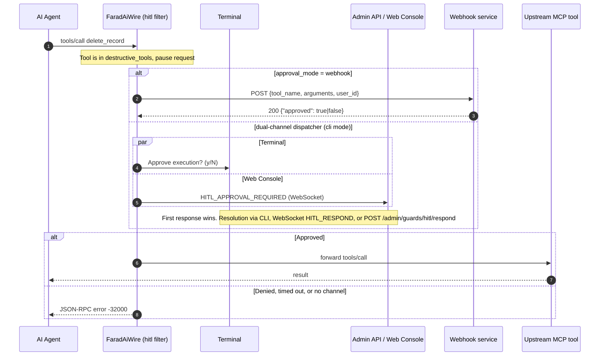

# Human-In-The-Loop (HITL) Interceptor

## What it does

Autonomous agents can call tools that are destructive or irreversible (dropping records, sending email, moving money). The `hitl` filter pauses a `tools/call` request for any tool listed in `destructive_tools` and waits for a human decision before the call is forwarded upstream. It fails closed: a denial, a timeout, or the absence of any operator channel all reject the call.

Related decisions: [ADR-0036](../adr/0036-unified-agent-tool-governance-and-hitl-action-matrix.md), [ADR-0040](../adr/0040-flb-rule-ingestion-first-class-hitl-action-and-canonicalization.md), [ADR-0054](../adr/0054-cross-platform-generic-filter-persistence-and-hitl-resolution.md).

## How it works

1. The filter only acts on `tools/call` requests. Every other method passes through untouched.
2. The tool name is lower-cased and trimmed, then matched against `destructive_tools`. A match is either exact, or on the part after the first `__` for aggregated names (`<protoSlug>__<tool>`). Matching is by exact name only, with no wildcards or regex.
3. If an upstream filter already recorded human approval for this request (for example DLP or Guard escalation), HITL does not prompt a second time.
4. Otherwise the approval channel is chosen:
   - `approval_mode: "webhook"` (case-insensitive): POST to `webhook_url`.
   - Any other value, with the gateway's dual-channel dispatcher attached (normal daemon operation): terminal and Admin Web Console are asked at the same time. The first answer wins and the other channel is dismissed.
   - Otherwise, a standalone terminal prompt (`y/N`), using `/dev/tty` on Unix/macOS, `CONIN$`/`CONOUT$` on Windows, or an interactive stdin/stdout.
5. On approval the request is forwarded. On denial, timeout or channel failure an error response is returned.



### Resolution channels

| Channel | How it resolves |
| --- | --- |
| Terminal | Answer to `Approve execution? (y/N)`. Anything other than an affirmative answer is a rejection. |
| Web Console | WebSocket message `{"type":"HITL_RESPOND","call_id":"...","approved":true}`. Pending requests are replayed to newly connected clients. |
| Admin REST | `POST /admin/guards/hitl/respond` with `{"call_id":"...","approved":true\|false}`. Returns 404 if the request is unknown or already resolved. `GET /admin/guards/hitl/pending` lists unresolved requests. |
| Webhook | The webhook's HTTP response body. See below. |

Resolution is atomic: only the first answer is applied, and later ones get `not found or already resolved`.

### Webhook contract (as implemented)

FaradAiWire sends a synchronous `POST` with `Content-Type: application/json`:

```json
{
  "tool_name": "transfer_funds",
  "arguments": { "account_to": "ACC-9921", "amount": 25000 },
  "user_id": "unknown"
}
```

The request is held open until the receiver answers. The response must be HTTP `200` with a JSON body such as `{"approved": true}` (body read is capped at 1 MiB). Any non-200 status, undecodable body, network error or timeout means rejection. There is no asynchronous callback URL, token or `request_id` in the payload: the decision is the HTTP response itself. `webhook_url` supports environment variable expansion (`$VAR`), and the URL is validated against the SSRF protection settings (`security.ssrf_protection`) before dispatch.

## Pipeline order and scope

- Order constant: `OrderHITL = 70` in `pkg/filter/filter.go`. It runs after rate limiting (10), loop protection (15), schema validation (30), DLP (50) and Guard (55), so only requests that survived those checks reach a human.
- Request path only. `ExecuteResponse` and `FilterResponse` are pass-throughs.
- The filter is built only when `filters.hitl.enabled` is true. It can also be toggled at runtime from the Admin Web Console; the toggle is stored as a sparse overlay in DuckDB `system_settings` and `config.yaml` is not rewritten (ADR-0053/0054).

## Configuration

All values below are configurable in `config.yaml` under `filters.hitl`. None are hard-coded limits of the product.

```yaml
filters:
  hitl:
    enabled: true
    destructive_tools:
      - "write_to_db"
      - "delete_record"
      - "send_email"
    approval_mode: "cli"      # "cli" or "webhook"
    webhook_url: ""           # required when approval_mode is "webhook"
    timeout_seconds: 60
```

| Field | Default | Notes |
| --- | --- | --- |
| `enabled` | `true` in the generated default config (`EnsureDefaultRuntimeConfig`); `false` if the key is omitted from your file (Go zero value) | Disabled means the filter is not built at all. |
| `destructive_tools` | `write_to_db`, `delete_record`, `send_email` in the generated config; empty if omitted | Exact tool names, case-insensitive. An empty list means nothing is ever paused. The Admin toggle fills in these three names if enabling with an empty list. |
| `approval_mode` | `cli` in the generated config | `webhook` selects webhook mode. Any other string behaves like `cli`. |
| `webhook_url` | empty | Used only in webhook mode. Empty in webhook mode rejects every destructive call. |
| `timeout_seconds` | `60` in the generated config; if `0` or negative the filter falls back to `300` | Bounds the wait for CLI and webhook. See caveat on the dispatcher timer below. |

Per-agent overrides: the `hitl` filter itself has no per-agent settings. Per-agent, per-tool governance exists in the Guard filter (`tool_governance` modes `autonomous`, `guarded_block`, `guarded_hitl`, `strict_always_hitl`), which uses the same dual-channel dispatcher. See the Guard page for details.

## Error response

Denial, timeout and channel failures are all returned as JSON-RPC error code `-32000` (`ErrHITLDenied` in `pkg/mcp/protocol.go`):

```json
{
  "jsonrpc": "2.0",
  "id": "req-9812",
  "error": {
    "code": -32000,
    "message": "Action denied: Destructive tool 'delete_record' was rejected by safety operator"
  }
}
```

Message variants:

| Cause | Message |
| --- | --- |
| Operator denied | `Action denied: Destructive tool '<name>' was rejected by safety operator` |
| Timeout | `Human-in-the-loop approval failed: human-in-the-loop approval timed out after 60s without operator interaction` |
| Headless, no console or Web Console client | `Human-in-the-loop approval failed: human-in-the-loop approval denied: headless environment with neither TTY nor Web Console attached` |
| Webhook mode without URL | `Human-in-the-loop approval failed: webhook mode configured without webhook URL` |
| Webhook failure | `Human-in-the-loop approval failed: webhook ...` (non-200 status, SSRF block, decode error, timeout) |
| Malformed `tools/call` params | `-32602` (invalid params), not `-32000` |

## Limits and known caveats

- **Dispatcher timer is fixed at 60s.** In dual-channel mode the dispatcher is created with `DefaultHITLDispatcherConfig()` (60 seconds). `timeout_seconds` only adds an outer context deadline, so the effective wait is the smaller of the two. Setting `timeout_seconds` above 60 does not extend dual-channel waits. In webhook and standalone-CLI paths, `timeout_seconds` is the real limit.
- **Timeout message says 60s regardless of config.** The text of the timeout error is a constant. If the outer `timeout_seconds` is below 60 and fires first, the dispatcher returns a context error and the message is `Human-in-the-loop approval failed: context deadline exceeded`.
- **Headless fail-closed.** With no terminal and no connected Web Console client, destructive calls are rejected immediately in cli mode. Headless daemons should use `approval_mode: "webhook"`.
- **Webhook mode bypasses the dual-channel dispatcher.** Web Console and Admin REST cannot resolve webhook-mode requests.
- **Webhook is synchronous and unauthenticated by FaradAiWire.** No signature or token header is added to the request.
- **Name-based matching only.** Arguments are not inspected. A destructive operation behind a tool not in the list is not paused, and renamed tools must be added manually.
- **Approvals are per call.** There is no "remember this approval" or batch approval.
- **Terminal prompts are serialized** by the dispatcher (one at a time), while the Web Console can show several.
- **Pending requests are in memory only.** A gateway restart drops them, and the waiting calls fail.
- **Webhook payload has no `request_id` or `callback_url`,** and the CLI prompt is the plain-text form shown in the code, not a boxed layout.

## Troubleshooting

| Symptom | Likely cause and fix |
| --- | --- |
| Every destructive call is rejected instantly | Headless environment. Attach a terminal or open the Web Console, or switch to `approval_mode: "webhook"`. Look for the log line `HITL escalation in headless environment`. |
| Tool is never paused | It is not in `destructive_tools` (exact name), the filter is disabled, or an upstream filter already marked the request as human-approved. |
| Approval prompt times out after 60s although `timeout_seconds: 300` | Dispatcher timer cap, see caveats. |
| Webhook mode always denies | Check `webhook_url` is set, the endpoint returns HTTP 200 with `{"approved": true}`, and the host is permitted by `security.ssrf_protection` (look for `Webhook URL rejected by SSRF guardrails`). |
| `POST /admin/guards/hitl/respond` returns 404 | The `call_id` is unknown, already resolved, or timed out. Use `GET /admin/guards/hitl/pending`. |
| Filter toggled in the console but `config.yaml` unchanged | Expected. Overrides live in DuckDB `system_settings`; use "Reset to Default" to return to the YAML value. |
| Windows terminal never prompts | The console is opened via `CONIN$`/`CONOUT$`. Services without an attached console fall into the headless path. |
