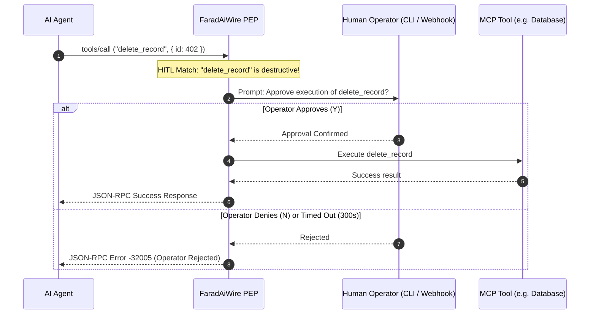

# Human-In-The-Loop (HITL) Interceptor 👤

While autonomous agents excel at reading and analyzing data, executing destructive or irreversible operations (e.g., dropping database tables, deleting records, sending emails, or executing financial transactions) introduces unacceptable enterprise risk.

FaradAiWire's **Human-In-The-Loop (HITL) Filter** ([ADR-0036](../adr/0036-unified-agent-tool-governance-and-hitl-action-matrix.md) & [ADR-0040](../adr/0040-flb-rule-ingestion-first-class-hitl-action-and-canonicalization.md)) pauses execution and requires explicit human operator authorization before destructive tool calls can proceed.



---

## Approval Modes

### 1. Interactive CLI Prompt (`approval_mode: "cli"`)
When running FaradAiWire in an interactive terminal, the gateway pauses the incoming HTTP/SSE connection and prints an interactive prompt to your terminal:

```text
┌────────────────────────────────────────────────────────┐
│ ⚠️  HITL SECURITY ESCALATION: DESTRUCTIVE ACTION       │
│                                                        │
│  Agent:      claude-code                               │
│  Tool:       delete_record                             │
│  Arguments:  {"table": "users", "id": 402}             │
│  Timeout:    300s remaining                            │
│                                                        │
│  Authorize execution? [y/N]:                           │
└────────────────────────────────────────────────────────┘
```

Type `y` and press Enter to approve execution. Pressing `n` or allowing the timer to expire immediately aborts the call.

---

### 2. Webhook Notification (`approval_mode: "webhook"`)
For headless servers or CI/CD pipelines, FaradAiWire dispatches a JSON POST payload to a designated webhook endpoint (such as a Slack bot, PagerDuty, or custom approval microservice):

```json
{
  "event": "hitl.approval.requested",
  "request_id": "req-9812",
  "agent_id": "cursor-worker",
  "tool_name": "transfer_funds",
  "arguments": {
    "account_to": "ACC-9921",
    "amount": 25000
  },
  "timeout_seconds": 300,
  "callback_url": "http://127.0.0.1:8095/admin/hitl/approve?token=a8f9c1..."
}
```

The external service approves or denies the request by making a callback to the tokenized endpoint.

---

## Configuration

In `config.yaml`:

```yaml
filters:
  hitl:
    enabled: true
    destructive_tools:
      - "write_to_db"
      - "delete_record"
      - "send_email"
      - "para_transferi"
      - "execute_command"
    approval_mode: "cli"        # "cli" (terminal prompt) or "webhook"
    webhook_url: ""             # Target URL when approval_mode is "webhook"
    timeout_seconds: 300        # Maximum time to wait before failing closed
```

---

## Error Handling & SLAs

If the operator rejects the action or the timeout expires, FaradAiWire returns JSON-RPC error `-32005`:

```json
{
  "jsonrpc": "2.0",
  "id": "req-9812",
  "error": {
    "code": -32005,
    "message": "Security policy violation: Tool execution rejected by human operator or approval timed out"
  }
}
```

This clear error message signals to the AI agent that the action was deliberately disallowed, preventing it from retrying the destructive action in an infinite loop.

