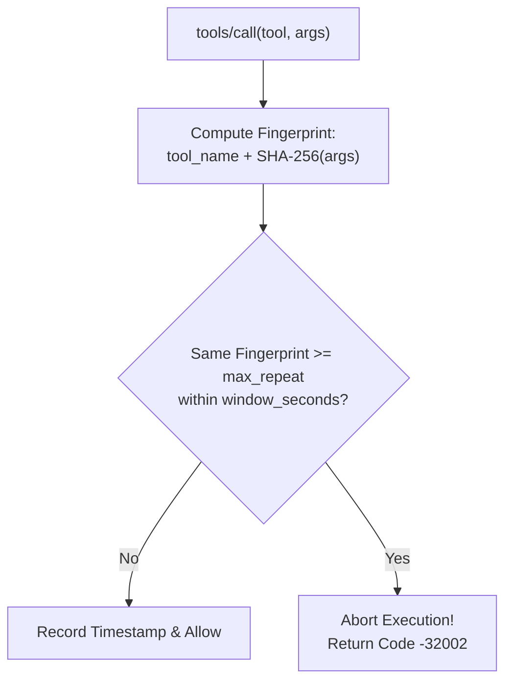

# Loop Protection & Rate Limiting ⏱️

Autonomous agents frequently suffer from hallucinations or unrecoverable error loops—repeatedly executing the exact same tool call with identical parameters dozens of times per second. This depletes API quotas, burns thousands of dollars in token billing, and risks taking down upstream services.

FaradAiWire provides two native in-memory defenses:
1. **Loop Protection Filter:** Detects and halts consecutive duplicate tool invocations.
2. **Token-Bucket Rate Limiter:** Enforces strict frequency and burst thresholds on tool executions.

---

## 1. Loop Protection (Runaway Prevention)

The **Loop Protection Filter** tracks tool call signatures over a sliding time window.



### How It Works:
1. For each `tools/call` received from an agent, FaradAiWire calculates a canonical hash of the tool name and normalized JSON arguments.
2. If the identical fingerprint is submitted consecutively $\ge \text{max\_repeat}$ times within `window_seconds`, FaradAiWire terminates the sequence immediately.
3. The agent receives a JSON-RPC 2.0 error `-32002`:
   ```json
   {
     "jsonrpc": "2.0",
     "id": "req-771",
     "error": {
       "code": -32002,
       "message": "Security policy violation: Infinite reasoning loop detected. Tool 'search_docs' called 4 consecutive times with identical arguments within 10s."
     }
   }
   ```
4. This explicit error forces the LLM to reconsider its strategy and break out of the cognitive dead-end.

---

## 2. Token-Bucket Rate Limiter

The **Rate Limiting Filter** prevents an agent or compromised plugin from flooding an upstream MCP server with tool requests.

- **Token Bucket Architecture:** Each client session is allocated a bucket with a maximum capacity (`max_burst`).
- Every tool call consumes 1 token.
- Tokens are continuously replenished at a rate of `refill_rate` tokens per second.
- If the token bucket is empty, requests are rejected with JSON-RPC error `-32000` (Rate limit exceeded) and an HTTP 429 status code.

---

## Configuration

In `config.yaml`:

```yaml
filters:
  # Loop Protection to block infinite reasoning loops on tools
  loop_protection:
    enabled: true
    max_repeat: 3               # Maximum consecutive identical calls allowed within the window
    window_seconds: 10          # Sliding time window in seconds

  # Token-Bucket Rate Limiter on tool execution frequency
  rate_limiting:
    enabled: true
    max_burst: 5                # Maximum token capacity (burst)
    refill_rate: 1.0            # Refill tokens per second
```

---

## Performance Characteristics

Both filters are implemented in Go with sub-millisecond execution times:
- **Loop Protection:** Uses in-memory ring buffers and pre-allocated map lookups; overhead $<0.05\text{ ms}$.
- **Rate Limiter:** Employs lock-free atomic timestamp math; overhead $<0.02\text{ ms}$.

