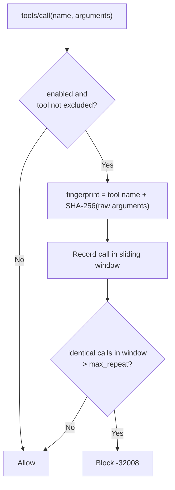

# Loop Protection

Autonomous agents sometimes get stuck: after an error or a hallucination they call the **same tool with identical arguments** again and again. This burns token budget and can hammer upstream services. **Loop Protection** (`loop_protection`) detects this pattern and returns an error that forces the model to change strategy.

## How it works



1. Only `tools/call` requests are inspected. Other methods and unparsable params pass through.
2. The filter resolves the effective settings: global values, then per-agent values, then a per-tool override for `max_repeat`.
3. Tools in the global `exclude_tools` list, or in the agent's own exclude list, are skipped.
4. A SHA-256 hash of the raw `arguments` JSON is computed. Two calls are identical when tool name and hash match.
5. The call is recorded under the key `agent:<agent>:user:<userID>:tool:<tool>` and old entries outside `window_seconds` are dropped.
6. If the number of identical calls inside the window is **greater than** `max_repeat`, the request is blocked.

With `max_repeat: 3` the first three identical calls are allowed and the fourth is blocked.

## Order and scope

| Property | Value |
| :--- | :--- |
| Filter name | `loop_protection` |
| Order constant | `OrderLoopProtection = 15` (after Rate Limiting) |
| Applies to | `tools/call` only |
| Tracking scope | Per agent, per user, per tool |

## Configuration

```yaml
filters:
  loop_protection:
    enabled: true
    max_repeat: 3                 # identical calls allowed inside the window
    window_seconds: 10            # sliding window length
    exclude_tools:                # never checked
      - "poll_status"
    overrides:                    # per-tool thresholds
      - tool: "search_docs"
        max_repeat: 10
    ttl_seconds: 300              # idle history lifetime
    cleanup_interval_seconds: 60  # background sweep period
    max_keys: 10000               # upper bound on tracked histories
```

| Field | Default | Description |
| :--- | :--- | :--- |
| `enabled` | `true` | Adds the filter to the pipeline. |
| `max_repeat` | `3` | Maximum identical calls per window. Values at or below zero fall back to `3`. |
| `window_seconds` | `10` | Window length in seconds. Values at or below zero fall back to `10`. |
| `exclude_tools` | empty | Tool names that bypass the check. |
| `overrides[].tool` / `.max_repeat` | none | Replaces `max_repeat` for that tool. Takes precedence over the agent value. |
| `ttl_seconds` | `300` | Idle histories are removed after this time. |
| `cleanup_interval_seconds` | `60` | Period of the background eviction sweep. |
| `max_keys` | `10000` | When exceeded, expired entries are pruned, then the least recently used one is evicted. |

> [!NOTE]
> The generated starter config uses `max_repeat: 5` and `window_seconds: 15`, while `config.example.yaml` and the code fallback use `3` and `10`. Set both values explicitly for your workload.

### Per-agent overrides

An agent definition may set `loop_protection.max_repeat`, `window_seconds` and `exclude_tools`. Values greater than zero replace the global ones for that agent, and the agent's exclude list is added to the global list.

## Error response

A detected loop returns `-32008` (`ErrLoopDetected`):

```json
{
  "jsonrpc": "2.0",
  "id": "req-771",
  "error": {
    "code": -32008,
    "message": "Infinite loop detected: tool called repeatedly with identical parameters"
  }
}
```

If the state store fails, the request is rejected with `-32603` (fail-closed).

## Limits and caveats

- **Raw argument hash.** The hash covers the exact bytes of `arguments`. The same logical call with a different key order or whitespace counts as a different call.
- **Varying arguments are not detected.** A loop where an argument changes every time (a counter, a timestamp) never matches. [Rate Limiting](/docs/wire/03-security-filters/rate-limiting/) still bounds such loops by volume.
- **Counts all identical calls in the window, not only consecutive ones.** Interleaving other calls does not reset the count.
- **Blocked attempts are recorded too.** While an agent keeps retrying, the count stays above the limit until the window passes without retries.
- **In memory and per process.** History is lost on restart and not shared between gateway instances.

## Troubleshooting

- **Polling tools are blocked.** Add them to `exclude_tools`, or raise `max_repeat` for that tool with `overrides`.
- **Legitimate retries are blocked.** Increase `max_repeat`, or shorten `window_seconds` so old calls expire sooner.
- **A loop is not caught.** Check whether arguments vary between calls (see caveats) and use Rate Limiting as a backstop.
