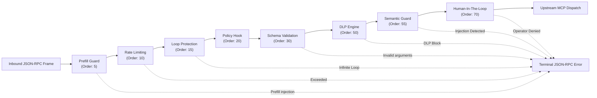

# Security Filter Pipeline Overview 🛡️

At the heart of FaradAiWire is an encapsulated, extensible security filter pipeline ([ADR-0014](../adr/0014-encapsulated-filter-pipeline-builder.md)). Every message received at the Proxy Ingress port (`8090`) traverses a deterministic chain of filters before tool execution is permitted.



---

## Security Controls

Each control has its own page with the exact behavior, every configurable value and its default, error codes and known limits:

| Control | Filter name | Page |
| :--- | :--- | :--- |
| Prefill Guard | `prefill_block` | [Prefill Guard](/docs/wire/03-security-filters/prefill/) |
| Rate Limiting | `rate_limiting` | [Rate Limiting](/docs/wire/03-security-filters/rate-limiting/) |
| Loop Protection | `loop_protection` | [Loop Protection](/docs/wire/03-security-filters/loop-protection/) |
| Schema Validation | `schema_validation` | [Schema Validation](/docs/wire/03-security-filters/schema-validation/) |
| Data Loss Prevention | `dlp` | [DLP](/docs/wire/03-security-filters/dlp/) |
| Semantic Guard | `guard` | [Neural Prompt Guard](/docs/wire/03-security-filters/prompt-guard/) |
| Human-In-The-Loop | `hitl` | [HITL](/docs/wire/03-security-filters/hitl/) |

---

## Canonical Pipeline Order & Precedence

Filters execute in strict ascending numerical order. If a lower-numbered filter returns a terminating verdict, execution stops immediately and higher-numbered filters are never evaluated. The values below are the constants in `pkg/filter`:

| Order Constant | Value | Filter Name | Purpose |
| :--- | :--- | :--- | :--- |
| `OrderPrefill` | `5` | `prefill_block` | Blocks requests whose message history ends with an assistant message (sockpuppeting) |
| `OrderRateLimit` | `10` | `rate_limiting` | Token-bucket limiter for tool calls |
| `OrderLoopProtection` | `15` | `loop_protection` | Detects repeated identical tool calls inside a sliding window |
| `OrderPolicy` | `20` | `policy` | Enterprise ABAC or custom policy hook ([ADR-0050](../adr/0050-absolute-opa-purge-and-open-core-policy-decoupling.md)) |
| `OrderSchemaValidation` | `30` | `schema_validation` | JSON schema validation of tool arguments and schema baseline tracking |
| `OrderDLP` | `50` | `dlp` | Regex scanner for credentials, private keys and PII |
| `OrderGuard` | `55` | `guard` | Regex tier plus local SLM classifier for prompt injection |
| `OrderInjectionScanner` | `60` | reserved | Constant for prompt injection scanning |
| `OrderHITL` | `70` | `hitl` | Interactive operator confirmation for destructive tools |

---

## Filter Outcomes

A filter does not return a verdict enum. The outcome is expressed through the return values of `FilterRequest` and `FilterResponse`:

- **Allow:** the filter returns the request or response unchanged with a `nil` error. The pipeline continues with the next filter.
- **Mask:** the filter returns a modified payload (for example sensitive values replaced with a placeholder such as `[REDACTED]`). The pipeline continues with the sanitized payload.
- **Block:** the filter returns a non-nil `*mcp.Error`. Execution stops and the JSON-RPC error is returned to the agent. Common codes are listed below.
- **Audit:** rules that only monitor append their names to the audit metadata of the request. The payload is not altered.
- **Human approval:** the DLP, Guard and HITL filters can pause the request until an operator approves or denies it. A denial or timeout is returned as `-32000`.

| Code | Constant | Raised by |
| :--- | :--- | :--- |
| `-32001` | `ErrPrefillInjection` | Prefill Guard |
| `-32002` | `ErrSchemaValidation` | Schema Validation |
| `-32004` | `ErrDLPViolation` | DLP, Guard |
| `-32006` | `ErrIndirectInjection` | Guard (response path) |
| `-32008` | `ErrLoopDetected` | Loop Protection |
| `-32009` | `ErrRateLimitExceeded` | Rate Limiting |
| `-32000` | `ErrHITLDenied` | HITL, DLP, Guard |

---

## Enabling & Disabling Filters

Configure which filters run in `config.yaml`:

```yaml
filters:
  prefill_block:
    enabled: true
  schema_validation:
    enabled: true
  dlp:
    enabled: true
  guard:
    enabled: true
  hitl:
    enabled: true
  loop_protection:
    enabled: true
  rate_limiting:
    enabled: true
```

*Changes take effect immediately at runtime via fsnotify hot-reload.*

---

## Extending FaradAiWire: Custom Go Filters

A filter implements `filter.SecurityFilter` from `pkg/filter` (`Name`, `Order`, `ExecuteRequest`, `ExecuteResponse`). Built-in filters such as the [Prefill Guard](/docs/wire/03-security-filters/prefill/) also implement `filter.RequestFilter` and keep the decision logic in `FilterRequest`. Returning a non-nil `*mcp.Error` from `ExecuteRequest` blocks the request; returning `nil, nil` lets it continue.

```go
package myfilter

import (
    "context"

    "github.com/FaradAiLab/FaradAiWire/pkg/filter"
    "github.com/FaradAiLab/FaradAiWire/pkg/mcp"
)

// MethodAllowlistFilter rejects every method that is not explicitly allowed.
type MethodAllowlistFilter struct {
    allowed map[string]bool
}

func NewMethodAllowlistFilter(methods ...string) *MethodAllowlistFilter {
    m := make(map[string]bool, len(methods))
    for _, name := range methods {
        m[name] = true
    }
    return &MethodAllowlistFilter{allowed: m}
}

func (f *MethodAllowlistFilter) Name() string { return "method_allowlist" }

// Order places the filter in the policy slot (20).
func (f *MethodAllowlistFilter) Order() int { return filter.OrderPolicy }

func (f *MethodAllowlistFilter) ExecuteRequest(ctx context.Context, req *mcp.Request) (*mcp.Response, error) {
    if !f.allowed[req.Method] {
        return nil, mcp.NewError(mcp.ErrInvalidParams, "method not allowed: "+req.Method, nil)
    }
    return nil, nil
}

func (f *MethodAllowlistFilter) ExecuteResponse(ctx context.Context, resp *mcp.Response) (*mcp.Response, error) {
    return resp, nil
}
```

Register the filter on the pipeline during bootstrap:

```go
pipeline.RegisterFilter(myfilter.NewMethodAllowlistFilter("initialize", "tools/list", "tools/call"))
```

> [!NOTE]
> `Pipeline` lives under `internal/filter`, so registering custom filters is possible for code inside the FaradAiWire module (for example a custom build or fork).
