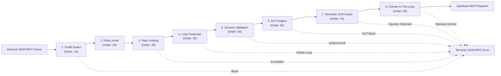

# Security Filter Pipeline Overview 🛡️

At the heart of FaradAiWire is an encapsulated, extensible security filter pipeline ([ADR-0014](../adr/0014-encapsulated-filter-pipeline-builder.md)). Every message received at the Proxy Ingress port (`8090`) traverses a deterministic chain of filters before tool execution is permitted.



---

## Canonical Pipeline Order & Precedence

Filters execute in strict ascending numerical order. If a lower-numbered filter returns a terminating verdict, execution stops immediately and higher-numbered filters are never evaluated:

| Order Constant | Value | Filter Name | Purpose | Execution Speed |
| :--- | :--- | :--- | :--- | :--- |
| `OrderPrefill` | `10` | `prefill_block` | Strips assistant prefill hijacking tokens | $<0.1\text{ ms}$ |
| `OrderPolicy` | `20` | `policy` | Enterprise ABAC or custom policy hook ([ADR-0050](../adr/0050-absolute-opa-purge-and-open-core-policy-decoupling.md)) | $<0.2\text{ ms}$ |
| `OrderRateLimit`| `30` | `rate_limiting` | Token-bucket frequency limiter | $<0.1\text{ ms}$ |
| `OrderLoop` | `35` | `loop_protection` | Sliding-window duplicate tool call detector | $<0.1\text{ ms}$ |
| `OrderSchema` | `50` | `schema_validation` | JSON schema type checking & drift pinning | $<0.3\text{ ms}$ |
| `OrderDLP` | `60` | `dlp` | Regex credentials, private keys, and PII scanner | $<0.5\text{ ms}$ |
| `OrderGuard` | `70` | `guard` | Neural SLM classifier (Prompt-Guard, Llama-Guard) | $15\text{--}40\text{ ms}$ |
| `OrderHITL` | `80` | `hitl` | Interactive operator confirmation for destructive tools | Interactive |

---

## Pipeline Verdicts

Each filter returns a `filter.Verdict` indicating how the message should proceed:

- **`VerdictAllow`:** The message is cleared without modification. The pipeline proceeds to the next filter.
- **`VerdictMask`:** The payload was mutated in-place (e.g. sensitive tokens replaced with `[REDACTED:...]`). The pipeline continues with the sanitized payload.
- **`VerdictAudit`:** A monitored rule matched. An audit event is logged, but payload bytes are not altered.
- **`VerdictBlock`:** Execution is aborted immediately. A JSON-RPC error frame (e.g. `-32004`) is returned to the agent.
- **`VerdictHITL`:** Request is paused awaiting human operator confirmation via CLI or Webhook.
- **`VerdictCritical`:** Internal error or panic recovered; request fails closed safely.

---

## Enabling & Disabling Filters

Configure which filters run in `config.yaml`:

```yaml
filters:
  prefill_block:
    enabled: true
  schema_validation:
    enabled: true
  dlp:
    enabled: true
  guard:
    enabled: true
  hitl:
    enabled: true
  loop_protection:
    enabled: true
  rate_limiting:
    enabled: true
```

*Changes take effect immediately at runtime via fsnotify hot-reload.*

---

## Extending FaradAiWire: Custom Go Filters

Developers can inject custom filters into FaradAiWire's pipeline by implementing the idiomatic `filter.Filter` interface:

```go
package myfilter

import (
    "context"
    "log/slog"
    "github.com/FaradAiLab/FaradAiWire/pkg/filter"
    "github.com/FaradAiLab/FaradAiWire/pkg/mcp"
)

// IPAllowlistFilter verifies client IP headers before tool execution.
type IPAllowlistFilter struct {
    allowedSubnet string
}

func NewIPAllowlistFilter(subnet string) *IPAllowlistFilter {
    return &IPAllowlistFilter{allowedSubnet: subnet}
}

func (f *IPAllowlistFilter) Name() string {
    return "ip_allowlist"
}

func (f *IPAllowlistFilter) Order() int {
    return filter.OrderPolicy // Injects at slot 20
}

func (f *IPAllowlistFilter) Execute(ctx context.Context, msg *mcp.Message) (filter.Verdict, error) {
    // Inspect context or message headers
    slog.Info("Evaluating custom policy filter", "tool", msg.Params.Name)
    
    // Return VerdictAllow, VerdictMask, or VerdictBlock
    return filter.NewAllowVerdict(), nil
}
```

Register the filter in your application bootstrap:
```go
pipeline.RegisterFilter(myfilter.NewIPAllowlistFilter("10.0.0.0/8"))
```

