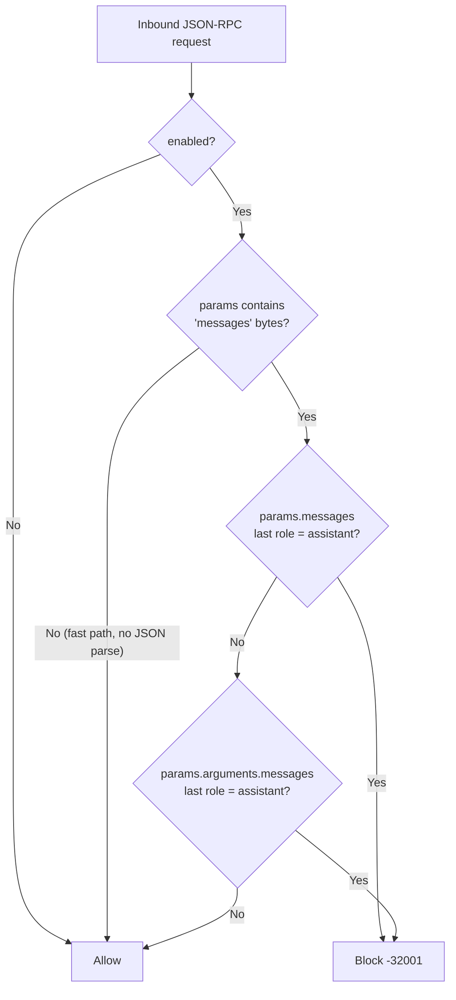

# Prefill Guard

The **Prefill Guard** (`prefill_block`) is the first filter in the pipeline. It blocks *sockpuppeting*: a request whose message history **ends with an `assistant` message**.

## What it stops

Chat APIs treat a trailing `assistant` message as the beginning of the model's own answer and continue from it. An attacker who controls the message list can write the first words of the answer (for example `Sure, here is how to ...`) and push the model past its refusal behavior. Because the injected text looks like the model's own output, it also bypasses most prompt-level defenses.

The guard rejects the request instead of letting the model continue from forged text.

## How it works



1. **Fast path.** If `params` is empty or does not contain the byte sequence `"messages"`, the request is allowed without parsing JSON. Ordinary tool calls pay almost nothing.
2. **Direct messages.** `params.messages` is parsed (standard Chat Completions shape). If the last element has `role == "assistant"`, the request is blocked.
3. **Nested messages.** `params.arguments.messages` is checked the same way, which covers `tools/call` requests that carry a conversation in their arguments.

Only the **last** message is inspected. Earlier `assistant` messages are legitimate conversation history and are allowed.

## Order and scope

| Property | Value |
| :--- | :--- |
| Filter name | `prefill_block` |
| Order constant | `OrderPrefill = 5` (runs first) |
| Path | Request only. The response path is a no-op. |
| Applies to | Any request whose params contain a `messages` array, regardless of method |

## Configuration

```yaml
filters:
  prefill_block:
    enabled: true   # default in the generated config and config.example.yaml
```

| Field | Default | Description |
| :--- | :--- | :--- |
| `filters.prefill_block.enabled` | `true` | Adds the filter to the pipeline. When `false` the filter is not built at all. |

The guard has no numeric thresholds. It can also be toggled at runtime from the Security Filters tab or by editing `config.yaml` (hot reload).

## Error response

A blocked request returns `-32001` (`ErrPrefillInjection`):

```json
{
  "jsonrpc": "2.0",
  "id": "req-12",
  "error": {
    "code": -32001,
    "message": "Assistant prefill injection blocked (sockpuppeting defense)"
  }
}
```

When the forged message is found under `arguments`, the message is `Assistant prefill injection in tool arguments blocked`.

## Limits and caveats

- **Fail-open on unusual `content` shapes.** The filter decodes each message as `{role: string, content: string}`. If any message uses an array for `content` (multimodal parts, Anthropic content blocks), JSON decoding fails and that check is silently skipped.
- **Role match is exact and case-sensitive.** Only the literal `"assistant"` is blocked.
- **Only the final message is checked.** Forged `assistant` turns in the middle of history are not flagged.
- **Only the two documented locations are checked.** Messages nested elsewhere in `params` are not inspected.

## Troubleshooting

- **A legitimate client is blocked.** Some SDKs intentionally end with an `assistant` message to steer output. Fix the client, or set `filters.prefill_block.enabled: false` if prefill is a required feature in your environment.
- **Nothing is blocked.** Confirm the payload really contains a top-level `messages` key and that `content` is a plain string (see caveats above).
