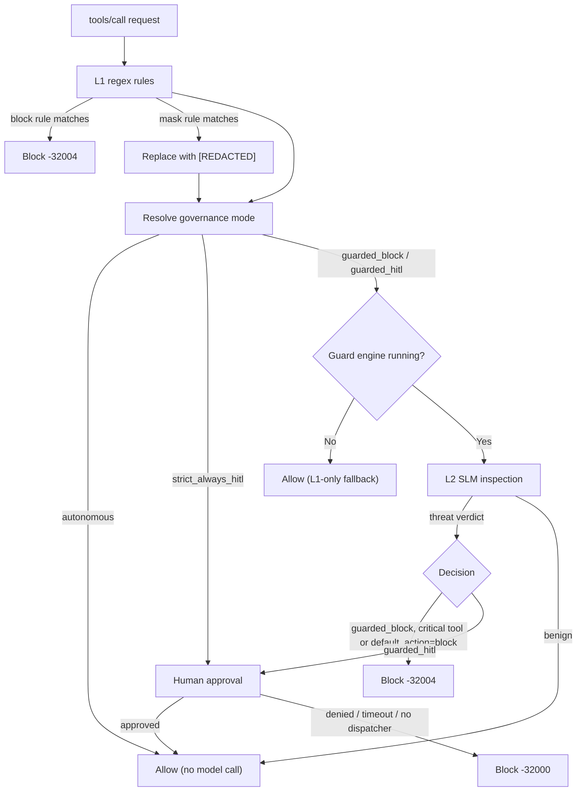

# Neural Prompt Injection Guard

The **Semantic Security Guard** (`guard`) combines a sub-millisecond regex tier (L1) with a neural tier (L2) that asks a local Small Language Model (SLM) whether a tool call or tool response looks malicious. No cloud API is involved: the model runs in your own Ollama, Docker sidecar or custom OpenAI-compatible endpoint.

It protects against two cases:

- **Direct injection / risky calls:** a `tools/call` whose arguments try to override instructions or perform a dangerous action.
- **Indirect injection:** a tool *response* (a web page, a document, an email) that carries hidden instructions aimed at the agent.

## How it works



### Request path (`tools/call`)

1. **L1 rules.** The raw `params` JSON is matched against the compiled rules. A `block` rule stops the request immediately. `mask` rules rewrite matches to `[REDACTED]` and the request continues with the sanitized params.
2. **Governance mode.** The mode is taken from the agent's per-tool governance setting. If none is configured, a default is chosen from the tool name:
   - matches `critical_blocks` gives `guarded_block`;
   - looks like external egress (the name contains `search`, `fetch`, `http`, `web`, `browser`, `mail`, `slack`, `webhook`, `download`, `upload`, `api` and similar keywords) gives `guarded_hitl`;
   - matches `fast_path_tools` and the arguments are short or structured gives `autonomous`;
   - anything else gives `guarded_block` when the active model's `default_action` is `block`, otherwise `guarded_hitl`.
3. **L2 inspection.** For `guarded_*` modes the tool name and arguments are sent to the active SLM.
4. **Verdict.** A verdict of `BLOCKED`, `SUSPICIOUS` or `THREAT` is a threat. Any other verdict except `BENIGN` or `SAFE` is a threat when its malicious probability is at least the threshold score.
5. **Action on a threat.**
   - Human-approved calls pass (Human Supremacy rule). The override is recorded in the audit metadata.
   - Critical tools and models with `default_action: block` are blocked with `-32004`.
   - `guarded_block` blocks with `-32004`.
   - `guarded_hitl` asks the operator through the dual-channel HITL dispatcher. Approval lets the call through, a denial, timeout or missing dispatcher blocks with `-32000`.

`strict_always_hitl` skips the model and always requires human approval before the tool runs.

### Response path (indirect injection)

Responses are scanned only when a tool name is known for the request, so `tools/list` and other static responses are skipped. The same L1 rules run on the result, then the L2 model inspects the output. Any threat is blocked with `-32006`. Responses never go through HITL.

For tools on the fast path, short responses (under 256 characters and not natural-language-like) skip the model.

## Order and scope

| Property | Value |
| :--- | :--- |
| Filter name | `guard` |
| Order constant | `OrderGuard = 55` (after DLP at 50) |
| Request path | `tools/call` only |
| Response path | Tool responses |

## Configuration

```yaml
filters:
  guard:
    enabled: true
    discovery:
      mode: "auto"                          # auto | ollama | docker | custom
      ollama_url: "http://127.0.0.1:11434"
      docker_url: "http://127.0.0.1:8088"
      custom_url: ""                        # OpenAI-compatible endpoint, for example vLLM
    max_payload_length: 128                 # characters
    min_word_count: 5                       # words
    fast_path_tools: [ "read_*", "get_*" ]  # optional, replaces the built-in list
    critical_blocks: [ "execute_command" ]  # optional, replaces the built-in list
    l1_patterns: []                         # optional, replaces the built-in rules
```

All values are configurable.

| Field | Default | Description |
| :--- | :--- | :--- |
| `enabled` | `true` in the generated config | Adds the filter to the pipeline. |
| `discovery.mode` | `auto` | How the inference provider is found. |
| `discovery.ollama_url` | `http://127.0.0.1:11434` | Ollama endpoint. |
| `discovery.docker_url` | `http://127.0.0.1:8088` | Docker sidecar endpoint. |
| `discovery.custom_url` | empty | Custom OpenAI-compatible endpoint. |
| `max_payload_length` | `128` | Fast-path calls with arguments longer than this (and above `min_word_count`) are promoted to the model. |
| `min_word_count` | `5` | Word threshold for the same promotion rule. |
| `fast_path_tools` | `read_*`, `get_*`, `search_*`, `list_*`, `query_*`, `describe_*`, `fetch_*`, `view_*` | Tool name patterns that skip the model when the call is simple. Setting a list replaces the defaults. |
| `critical_blocks` | `execute_bash`, `execute_command`, `run_command`, `exec_*`, `*exec*`, `drop_db`, `delete_database`, `format_disk` | Tools hard-blocked on a threat verdict. Setting a list replaces the defaults. |
| `l1_patterns` | `system_override` (block), `sensitive_files` (block), `api_key_redact` (mask) | Regex rules with `name`, `regex`, `action` (`block` or `mask`). Invalid regexes are skipped. Setting a list replaces the defaults. |

Runtime settings (Settings in the Web Console, stored in the operational settings cache):

| Setting | Default | Description |
| :--- | :--- | :--- |
| Guard threshold score | `0.50` | Minimum malicious probability that counts as a threat. Lower is stricter. |
| Guard HITL timeout | `60` seconds | Wait time for operator approval. Follows `filters.hitl.timeout_seconds` when set. |

> [!NOTE]
> The `confidence_threshold` and `timeout_ms` keys that appear in older documentation are not read by the guard. Use the threshold score setting above.

### Per-agent overrides

An agent can set a tool governance mode per tool (`autonomous`, `guarded_block`, `guarded_hitl`, `strict_always_hitl`). A configured mode takes precedence over the default selection described above.

## Error responses

| Code | When |
| :--- | :--- |
| `-32004` | An L1 block rule matched, or a threat was hard-blocked on the request path. |
| `-32006` | A threat or L1 block rule matched in a tool response (indirect injection). |
| `-32000` | Human approval was denied, timed out, or the dispatcher is unavailable. |

```json
{
  "jsonrpc": "2.0",
  "id": "req-41",
  "error": {
    "code": -32006,
    "message": "Security Alert: Indirect prompt injection detected in tool 'fetch_page' response by Semantic Security Guard (PROMPT_INJECTION - CWE-77)",
    "data": { "tool": "fetch_page", "score": 0.93, "cwe": "CWE-77" }
  }
}
```

## Limits and caveats

- **Fail-open when the model is unavailable.** If the engine is stopped, the queue is full, or inspection returns an error, the call or response is allowed after L1 and a warning is logged (an operator notification is sent when the engine is disconnected). Only L1 rules protect you in that state.
- **Autonomous tools are never sent to the model.** Calls to fast-path tools with short arguments are allowed without L2. Tune `fast_path_tools`, `max_payload_length` and `min_word_count` with this in mind.
- **Name-based defaults are heuristics.** The external-egress keyword list and the critical-tool patterns work on tool names only.
- **L1 scans raw JSON.** Rules match the whole serialized `params` or `result`, including keys.
- **`mask` on the response path rewrites raw JSON text** and can produce unusual output if a match spans structure.
- **Human approval overrides model verdicts** for calls already approved earlier in the pipeline.
- **Latency depends on the model and hardware.** There is no fixed latency guarantee.

## Troubleshooting

- **Guard seems inactive.** Run `faradaiwire doctor` and `faradaiwire guard status` to check that a provider was discovered and the engine is running. Without a running engine only L1 applies.
- **Too many false positives.** Raise the threshold score, add safe tools to `fast_path_tools`, or set the tool to `autonomous` for that agent.
- **A dangerous tool is not blocked.** Add it to `critical_blocks`, or set `guarded_block` for that tool.
- **Approval prompts time out.** Increase the HITL timeout (`filters.hitl.timeout_seconds`).
- **Start a local engine.** Ollama: `ollama pull llama-guard3:1b`. Docker sidecar: `docker run -d -p 8088:8088 ghcr.io/faradailab/prompt-guard:latest`.
