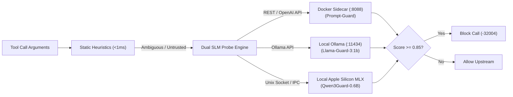

# Neural Prompt Injection Guard 🛡️

While regex and static heuristics intercept known exploit signatures in $<1\text{ ms}$, sophisticated indirect prompt injections and jailbreak attacks require semantic evaluation. FaradAiWire provides an extensible **Neural Semantic Security Guard** ([ADR-0032](../adr/0032-extensible-slm-security-guard-and-stdio-mcp-engine.md) & [ADR-0042](../adr/0042-single-model-semantic-guard-and-runtime-pipeline.md)) powered by local Small Language Models (SLMs).



---

## Supported SLM Models & Engines

FaradAiWire interfaces with local inference engines running on developer workstations with zero cloud API keys:

| Model ID | Architecture | Typical Latency | RAM Footprint | Provider |
| :--- | :--- | :--- | :--- | :--- |
| **`prompt-guard`** | Meta PromptGuard (86M) | $12\text{--}18\text{ ms}$ | $\approx 250\text{ MB}$ | Docker Sidecar (`ghcr.io/faradailab/prompt-guard:latest`) |
| **`llama-guard3:1b`** | Llama Guard 3 (1B Q4) | $22\text{--}35\text{ ms}$ | $\approx 1.1\text{ GB}$ | Local Ollama |
| **`qwen3guard-0.6b`** | Qwen 2.5 Guard (0.6B) | $15\text{--}25\text{ ms}$ | $\approx 600\text{ MB}$ | Ollama / MLX / vLLM |
| **`granite-guardian`** | IBM Granite 3.0 (2B) | $30\text{--}45\text{ ms}$ | $\approx 1.8\text{ GB}$ | Ollama |

---

## Quick Setup: Starting a Local Guard Engine

### Option A: Local Ollama (Recommended for macOS & Linux)
1. Install [Ollama](https://ollama.ai).
2. Pull the lightweight guard model:
   ```bash
   ollama pull llama-guard3:1b
   ```
3. FaradAiWire will automatically discover and link it on startup.

### Option B: Docker Sidecar (Recommended for Containerized Environments)
```bash
docker run -d -p 8088:8088 --name prompt-guard ghcr.io/faradailab/prompt-guard:latest
```

---

## Verifying & Managing Guards via CLI

FaradAiWire provides dedicated subcommands to inspect and manage inference engines:

### Diagnose Providers:
```bash
faradaiwire doctor
```
*Discovers running Ollama or Docker endpoints and tests round-trip inference latency.*

### List Installed Models:
```bash
faradaiwire guard list
```

```text
AVAILABLE SLM MODELS:
 ID                   NAME                 PROVIDER    PARADIGM        STATUS
 prompt-guard-docker  Meta PromptGuard     docker      Classification  READY (8088)
 llama-guard3:1b      Llama Guard 3 1B     ollama      DecisionModel   READY (11434)
 qwen3guard-0.6b      Qwen3 Guard 0.6B     ollama      DecisionModel   AVAILABLE
```

### Check Active Guard Status:
```bash
faradaiwire guard status
```

---

## Configuration

In `config.yaml`:

```yaml
filters:
  guard:
    enabled: true
    discovery:
      mode: "auto"              # "auto" (dual probe), "ollama", "docker", or "custom"
      ollama_url: "http://127.0.0.1:11434"
      docker_url: "http://127.0.0.1:8088"
      custom_url: ""            # Optional OpenAI-compatible endpoint (e.g. vLLM)
    confidence_threshold: 0.85  # Confidence score (0.00 to 1.00) required to trigger block
    timeout_ms: 1500            # Fallback timeout before failing closed or passing to fast-path
```

---

## Visualizing Guard Decisions in the Web Console

Open **`http://localhost:8095/admin/dashboard`** and click the **Guards** tab:
- **Interactive Playground:** Test arbitrary prompt injection payloads against your active local SLM to observe confidence scores and latency breakdowns.
- **Hardware Telemetry Bar:** Real-time host CPU, RAM, and GPU memory usage.
- **GQA KV Cache Calculator:** Accurately estimates memory requirements when scaling context windows from 2K to 8K tokens.

