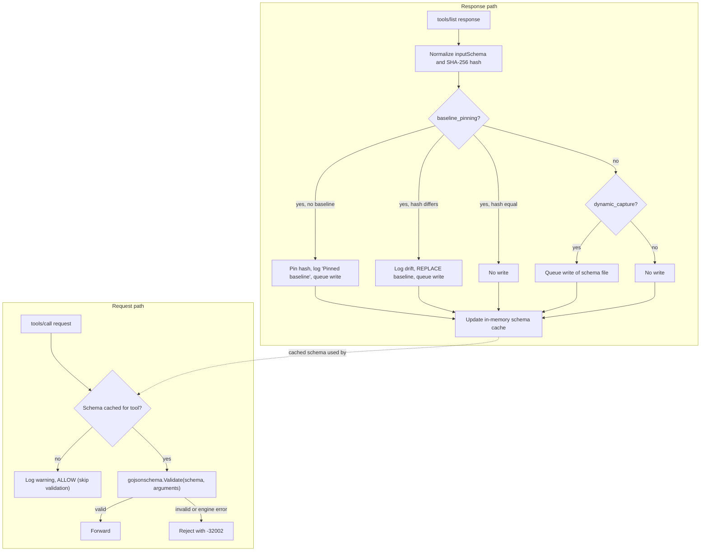

# Runtime JSON Schema Validation & Drift Pinning

The `schema_validation` filter learns each tool's `inputSchema` from `tools/list` responses and validates every later `tools/call` argument object against that learned schema. This page describes only behavior verified in the source (`internal/filter/schema/schema.go`, `internal/filter/pipeline_exec.go`, `internal/config/provider.go`, `pkg/mcp/protocol.go`).

## 1. What it does and which attack it stops

- **Parameter injection / malformed arguments.** A `tools/call` whose `arguments` violate the tool's JSON Schema (missing required fields, wrong types, out-of-range values, enum violations, extra properties when the schema forbids them) is rejected before it reaches the upstream server.
- **Schema observation for tool poisoning.** Each tool schema is hashed (SHA-256) and stored as a baseline. A changed schema is detected and logged, but it is not blocked (see [Limits and caveats](#6-limits-and-known-caveats)).

The filter does not inspect tool descriptions, only `inputSchema`.

## 2. How it works



Verified details:

1. **Capture (response path).** `FilterResponse` tries to parse any response `result` as `{"tools":[{name, description, inputSchema}]}`. If parsing fails or the list is empty, the response passes through untouched. For each tool the schema is normalized (unmarshal and re-marshal for a deterministic form) and hashed.
2. **Cache.** Regardless of the two flags above, every captured schema is placed in the in-memory cache (exact name and lowercase name). Validation therefore works as soon as a `tools/list` has been seen, even with `dynamic_capture: false` and `baseline_pinning: false`.
3. **Persistence.** File writes are asynchronous (write-behind worker, queue of 512 tasks). Each tool is written to `<schemas_dir>/<tool name>.json`, and the whole tool list to `<schemas_dir>/mcp_tools.json`. If the optional DuckDB schema store is wired, records are also saved there (5 second timeout per save).
4. **Startup load.** On construction, if `schemas_dir` is non-empty, every `*.json` file in it (except `mcp_tools.json`) is loaded into the cache and baseline map, so previously learned schemas are enforced immediately after a restart.
5. **Validation (request path).** The tool name and `arguments` are read from `params`. Missing or `null` arguments are validated as `{}`. Matching is by exact tool name first, then case-insensitive.

## 3. Pipeline order and scope

- Filter name: `schema_validation`. Order: `OrderSchemaValidation = 30` (after prefill 5, rate limit 10, loop protection 15 and policy 20; before DLP 50, guard 55, injection scanner 60 and HITL 70).
- **Request path:** acts only on method `tools/call`. All other methods (`initialize`, `tools/list`, `resources/*`, `prompts/*`, ...) are passed through unchanged.
- **Response path:** acts on any response whose `result` parses as a non-empty `tools` array, i.e. `tools/list` results.
- **Adaptive routing:** `schema_validation` is in `FastPathFilterNames`, so it runs on both the fast and deep paths.
- The filter is only added to the pipeline when `filters.schema_validation.enabled` is `true`.

## 4. Configuration

These values are configurable in `config.yaml`; the values below are the ones written into the default standalone config generated by `internal/config/provider.go`.

```yaml
filters:
  schema_validation:
    enabled: true
    schemas_dir: "<home>/.faradaiwire/schemas"   # default is derived from DefaultFaradAiWireDir()
    dynamic_capture: true
    baseline_pinning: true
```

| Field | Type | Default (generated config) | Effect |
|---|---|---|---|
| `enabled` | bool | `true` | Adds the filter to the pipeline. If `false`, no capture and no validation. |
| `schemas_dir` | string | `<wire dir>/schemas` | Directory for per-tool schema files and `mcp_tools.json`. Created with mode `0750`. If empty, nothing is loaded from or written to disk (in-memory only). |
| `dynamic_capture` | bool | `true` | Writes schema files from `tools/list` responses. Only takes effect when `baseline_pinning` is `false` (see caveats). |
| `baseline_pinning` | bool | `true` | Tracks a SHA-256 baseline per tool, logs first pin and later changes, writes files. |

Notes:

- If `schema_validation` is omitted from `config.yaml`, the Go struct zero values apply (`enabled: false`, empty `schemas_dir`, both flags `false`).
- When the filter is switched on at runtime through the settings overlay (`filters.schema_validation`), and `schemas_dir` is empty and both flags are false, the code fills `schemas_dir` with the default path and sets both flags to `true`.
- **Per-agent overrides:** none. `SchemaValidationConfig` has only the four fields above and no per-agent or per-tool override mechanism (unlike `loop_protection`, which has `overrides`).

## 5. Error response

Rejected calls return JSON-RPC error code `-32002` (`mcp.ErrSchemaValidation`). The message and `data` come from the filter:

```json
{
  "jsonrpc": "2.0",
  "id": "call-105",
  "error": {
    "code": -32002,
    "message": "Tool arguments validation failed: [port: Invalid type. Expected: integer, given: string]",
    "data": {
      "errors": ["port: Invalid type. Expected: integer, given: string"],
      "tool": "scan_port"
    }
  }
}
```

The exact error strings come from the `gojsonschema` library. Other cases:

- Unparseable `params` on a `tools/call`: code `-32602` (`ErrInvalidParams`), message `Failed to parse tool call params: ...`.
- Validation engine failure (for example a cached schema that is not valid JSON Schema): code `-32002`, message `JSON Schema validation engine error: ...`.

The pipeline records every block as a `BLOCKED` audit event with `filter_name = schema_validation` and the error code.

## 6. Limits and known caveats

- **Drift is logged, not blocked.** When a tool's schema hash changes and `baseline_pinning` is on, the code logs `Tool schema update/drift detected, updating stored baseline`, replaces the baseline and file, and updates the cache. The request is not rejected and no alert is emitted beyond the log line. The constant `ErrToolSchemaDrift` (`-32007`) exists in `pkg/mcp` but is not used by this filter. The "baseline" is therefore a change log, not an immutable pin.
- **Schema rug-pull is not prevented.** Because the new schema replaces the old one, a malicious upstream can loosen its schema and later calls are validated against the loosened version.
- **Fail-open when no schema is known.** A `tools/call` for a tool with no cached schema is allowed with only a warning log. This happens for tools never listed through the gateway, and for the first call before any `tools/list` has been observed.
- **First-seen trust.** The first schema seen is trusted without verification.
- **Dropped persistence.** If the 512-task write queue is full, writes are dropped with a warning; in-memory validation still works. Disk or DuckDB write errors are logged and otherwise ignored.
- **Flag interaction.** `dynamic_capture` only triggers writes when `baseline_pinning` is `false`. With `baseline_pinning: true`, `dynamic_capture` has no additional effect. Also, with `baseline_pinning: false`, an existing file is only rewritten when a response is captured (no hash comparison).
- **No input-schema fallbacks.** Tools without a valid `inputSchema` in `tools/list` are cached with whatever raw value was supplied; a schema that fails to normalize is skipped for that tool (error logged), so that tool stays unvalidated.
- **Arguments only.** Tool descriptions, output schemas and tool responses are not validated.
- **Extra properties and bounds** are enforced only as far as the tool's own schema declares them (for example `additionalProperties: false`, `minimum`, `maxLength`, `enum`). The filter does not add stricter rules of its own.
- **Name matching.** Names are matched exactly, then case-insensitively; a filename-unsafe tool name is subject to the sandboxed path check when writing and may fail to persist.
- **Startup read.** Schema files in `schemas_dir` that are not valid JSON are skipped (logged).

## 7. Troubleshooting

| Symptom | Likely cause | Action |
|---|---|---|
| Log: `No JSON Schema cached for tool, skipping validation` | No `tools/list` has been seen for that tool through the gateway | Have the client call `tools/list` first, or place `<tool>.json` in `schemas_dir` and restart |
| Valid calls rejected with `-32002` after an upstream upgrade | Cached schema is stale (for example loaded from disk) | Re-run `tools/list`; with `baseline_pinning: true` the baseline is refreshed. Otherwise clear baselines (below) |
| `JSON Schema validation engine error` | Cached schema is malformed | Inspect `<schemas_dir>/<tool>.json`; delete it and re-list tools |
| No files appear in `schemas_dir` | `schemas_dir` empty, both flags `false`, directory not writable, or write queue saturated | Check config, permissions and log lines `Failed to write schema file` / `Write-behind buffer saturated` |
| Filter not active | `enabled: false` or section missing | Set `filters.schema_validation.enabled: true` and reload |

Resetting baselines: `POST /admin/schemas/clear` on the admin server (a mutation endpoint; use the admin authentication your deployment requires). It calls `ClearBaselines()`, which empties the in-memory cache and baselines and deletes all `*.json` files directly in `schemas_dir`. Deleting a single file on disk does not clear the in-memory entry until the process reloads or the baselines are cleared. Schemas are re-learned on the next `tools/list`.
