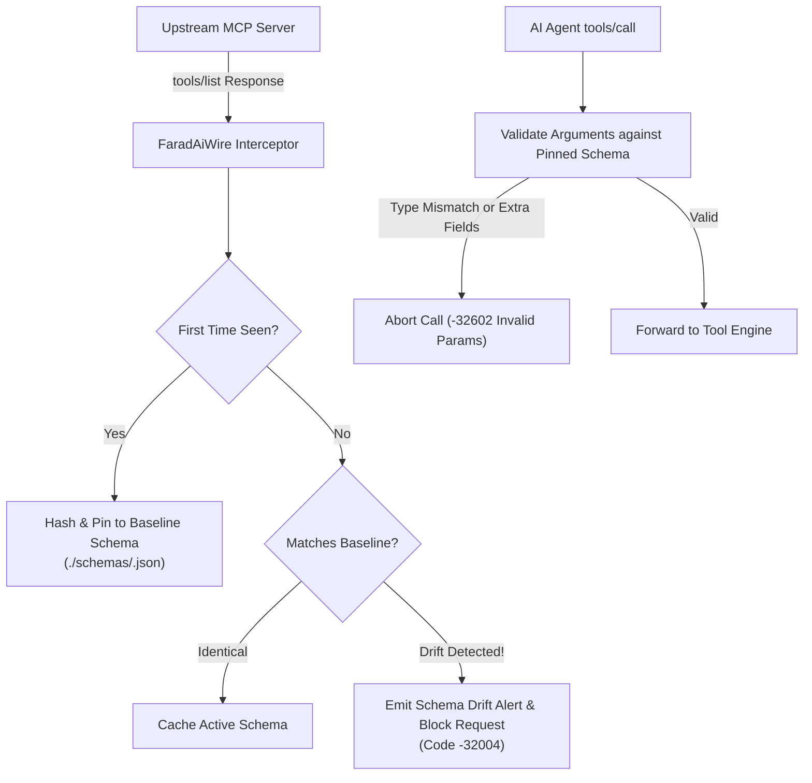

# Runtime JSON Schema Validation & Drift Pinning 📋

Model Context Protocol (MCP) tool servers expose their interfaces via the `tools/list` JSON-RPC method. In production environments, an attacker who compromises an upstream tool server or updates an untrusted MCP package can perform **Tool Poisoning** or **Schema Rug-Pulling**—changing parameter descriptions to trick an agent or adding hidden required parameters.

FaradAiWire's **Schema Validation Filter** ([ADR-0037](../adr/0037-mcp-attachment-ux-protocol-contract-and-schema-observability.md)) eliminates this attack vector by establishing immutable baseline pinning and enforcing strict runtime type checking.



---

## 1. Dynamic Capture & Baseline Pinning

When `dynamic_capture` is enabled:
1. FaradAiWire intercepts all `tools/list` response payloads received from upstream tools.
2. For each tool definition, FaradAiWire calculates a SHA-256 fingerprint of the `inputSchema` specification.
3. If no pinned baseline exists in `./schemas/`, FaradAiWire serializes the canonical schema to disk.
4. On subsequent `tools/list` calls, FaradAiWire compares the upstream schema against the pinned baseline. If any parameter is added, removed, or mutated, FaradAiWire blocks execution to protect against rug-pull attacks.

---

## 2. Runtime Argument Type Validation

Before an agent's `tools/call` frame reaches an upstream tool, FaradAiWire validates incoming arguments against the pinned JSON Schema:
- **Required Fields:** Ensures all mandatory properties are present.
- **Type Checking:** Ensures strings, integers, arrays, and objects conform to defined types.
- **Bounds Checking:** Validates `minimum`, `maximum`, `minLength`, `maxLength`, and enum values.
- **Disallowed Additional Properties:** Rejects payloads containing unexpected extra properties that could be exploited for command injection.

If validation fails, FaradAiWire returns a JSON-RPC 2.0 error:
```json
{
  "jsonrpc": "2.0",
  "id": "call-105",
  "error": {
    "code": -32602,
    "message": "Invalid params: argument 'port' must be an integer between 1 and 65535, got string 'abc'"
  }
}
```

---

## Configuration

In `config.yaml`:

```yaml
filters:
  schema_validation:
    enabled: true
    schemas_dir: "./schemas/"    # Path to store pinned JSON schemas
    dynamic_capture: true         # Intercept tools/list responses to cache schemas dynamically
    baseline_pinning: true        # Pin first-seen schemas and alert on drift/poisoning
```

---

## Updating or Resetting Schemas

When legitimately updating an upstream tool's version:

### Via Admin REST API:
```bash
curl -X POST http://127.0.0.1:8095/admin/schemas/clear \
  -H "Authorization: Bearer dev-local-key"
```

### Via Filesystem:
Delete the specific tool's cached schema file from `./schemas/<tool-name>.json` and restart or hot-reload FaradAiWire.

