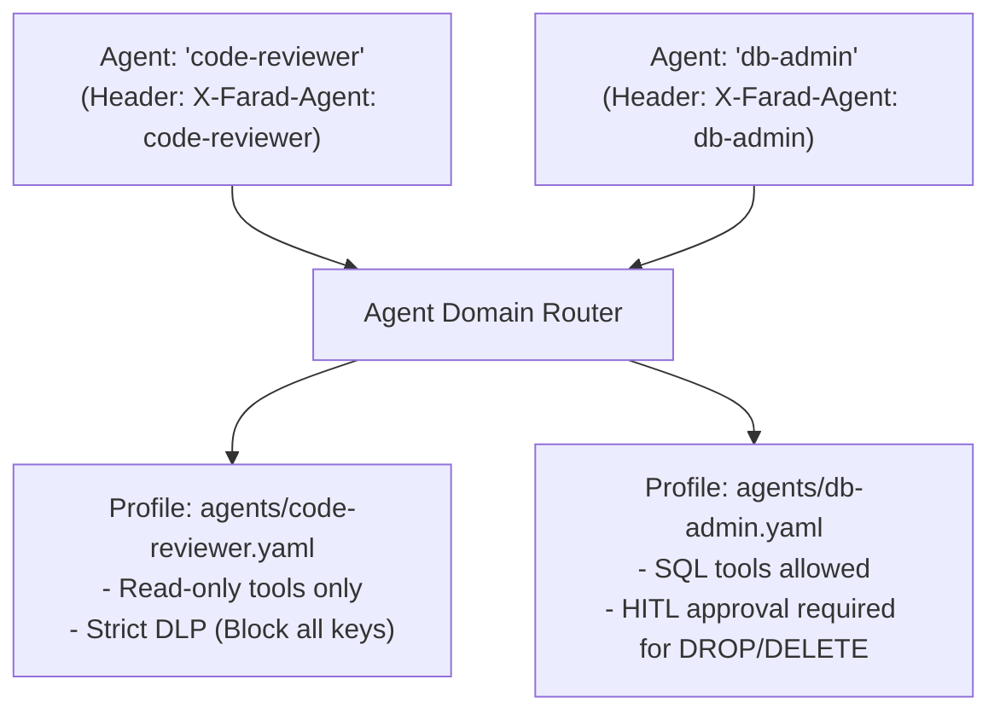

# Multi-Agent Domain Isolation 👥

Developer environments frequently run multiple specialized AI agents simultaneously—for example, a `code-reviewer` agent, an autonomous `database-migrator`, and a `support-assistant`. Each agent requires different tool privileges and data access limits.

FaradAiWire supports **Per-Agent Domain Isolation** ([ADR-0015](../adr/0015-unified-hot-reload-and-multi-agent-domain-isolation.md)), allowing you to define granular security profiles for each agent persona in the `agents/` directory.



---

## 1. Defining Agent Profiles

In your project's `agents/` folder (configured via `agents_dir: "./agents"` in `config.yaml`), create a YAML file for each agent persona:

### Example: `agents/code-reviewer.yaml`
```yaml
name: "code-reviewer"
description: "Read-only agent for pull request code review"

# Granular tool authorization
tool_governance:
  allowed_tools:
    - "read_file"
    - "list_directory"
    - "git_diff"
    - "git_status"
  denied_tools:
    - "write_file"
    - "delete_file"
    - "execute_command"

# Per-agent DLP rules
dlp:
  # Stricter action for this agent: block instead of mask
  overrides:
    - pattern_name: "aws_credentials"
      action: "block"
```

### Example: `agents/db-admin.yaml`
```yaml
name: "db-admin"
description: "Database maintenance agent"

tool_governance:
  allowed_tools:
    - "query_db"
    - "execute_migration"

hitl:
  destructive_tools:
    - "execute_migration"
```

---

## 2. Invoking with Agent Domain Headers

When AI agent clients send tool requests, they include the `X-Farad-Agent` HTTP header:

```bash
curl -X POST http://127.0.0.1:8090/message \
  -H "Authorization: Bearer dev-local-key" \
  -H "X-Farad-Agent: code-reviewer" \
  -H "Content-Type: application/json" \
  -d '{
    "jsonrpc": "2.0",
    "id": "1",
    "method": "tools/call",
    "params": { "name": "execute_command", "arguments": { "cmd": "rm -rf /" } }
  }'
```

FaradAiWire evaluates the request against `agents/code-reviewer.yaml`. Because `execute_command` is explicitly listed under `denied_tools`, FaradAiWire rejects the call with JSON-RPC error `-32003` (`Policy authorization denied: tool 'execute_command' is not permitted for agent 'code-reviewer'`).

---

## 3. Fallback Behavior

If an incoming request does not provide an `X-Farad-Agent` header:
- FaradAiWire applies the fallback profile defined by `FARADAI_WIRE_DEFAULT_AGENT` (default: `default`).
- If no `agents/default.yaml` exists, global rules defined in `config.yaml` apply.

