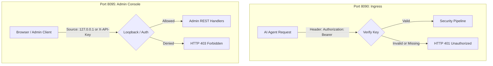

# API & Protocol Reference Overview 📋

FaradAiWire exposes two distinct networking interfaces governed by physical port segregation:

1. **Proxy Ingress API (Port 8090):** Streamed JSON-RPC 2.0 interface for AI agents (Claude Code, Cursor, Windsurf, custom SDKs).
2. **Admin REST API (Port 8095):** Administrative control plane for configuration management, schema inspection, live telemetry, and Web Console UI.

---

## Authentication Schemes

---

## OpenAPI 3.1 Specification

The complete, machine-readable OpenAPI 3.1 definition for all FaradAiWire Admin and Ingress endpoints is maintained in the repository:
👉 **[`api/openapi.yaml`](https://github.com/FaradAiLab/FaradAiWire/blob/main/api/openapi.yaml)**

You can import this contract into Postman, Swagger UI, Insomnia, or code generation tools.

