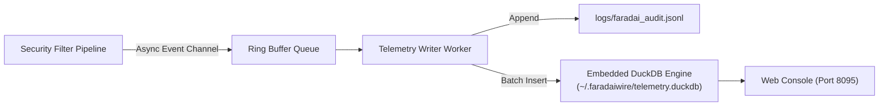

# Telemetry & Audit Logging 📊

FaradAiWire provides comprehensive, tamper-evident audit logging for every MCP tool call without transmitting data to external cloud monitoring services.

---

## Telemetry Storage Architecture

Telemetry is recorded across two synchronized local stores:
1. **Structured JSONL File (`logs/faradai_audit.jsonl`):** Append-only newline-delimited JSON stream for SIEM ingestion, `jq` parsing, or `tail -f`.
2. **Embedded DuckDB Database (`~/.faradaiwire/telemetry.duckdb`):** High-performance analytical columnar database for microsecond SQL queries and Web Console reporting.



---

## Audit Event JSON Schema

Each log entry records complete execution and provenance metadata:

```json
{
  "id": "evt_9a81b2c4",
  "timestamp": "2026-10-30T21:10:00.124Z",
  "gateway_id": "faradaiwire-gw-local-01",
  "session_id": "sess_default_01",
  "agent_id": "claude-code",
  "user_id": "guest-customer",
  "user_role": "Developer",
  "tool_name": "query_database",
  "verdict": "MASKED",
  "filter_name": "dlp",
  "rule_name": "credit_card",
  "duration_ms": 0.42,
  "client_ip": "127.0.0.1",
  "params_summary": "SELECT card_number FROM orders WHERE id=10"
}
```

---

## Querying Telemetry with DuckDB SQL

You can query FaradAiWire's embedded DuckDB database directly using the DuckDB CLI or Python/Node SDKs:

### 1. View Top Blocked Rules:
```sql
SELECT rule_name, COUNT(*) as block_count
FROM audit_events
WHERE verdict = 'BLOCKED'
GROUP BY rule_name
ORDER BY block_count DESC
LIMIT 5;
```

### 2. Average Latency by Tool:
```sql
SELECT tool_name, 
       ROUND(AVG(duration_ms), 2) as avg_latency_ms,
       COUNT(*) as total_calls
FROM audit_events
GROUP BY tool_name
ORDER BY total_calls DESC;
```

---

## Log Rotation

By default, FaradAiWire rotates `logs/faradai_audit.jsonl` when the file reaches 50 MB, retaining up to 5 compressed backup archives (`faradai_audit-YYYY-MM-DD.jsonl.gz`).

