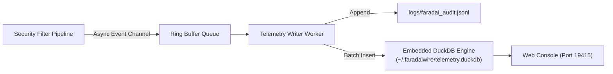

# Telemetry & Audit Logging 📊

FaradAiWire provides comprehensive, tamper-evident audit logging for every MCP tool call without transmitting data to external cloud monitoring services.

---

## Telemetry Storage Architecture

Telemetry is recorded across two synchronized local stores:
1. **Structured JSONL File (`logs/faradai_audit.jsonl`):** Append-only newline-delimited JSON stream for SIEM ingestion, `jq` parsing, or `tail -f`.
2. **Embedded DuckDB Database (`~/.faradaiwire/telemetry.duckdb`):** High-performance analytical columnar database for microsecond SQL queries and Web Console reporting.



---

## Audit Event JSON Schema

Each log entry records complete execution and provenance metadata:

```json
{
  "id": "evt_9a81b2c4",
  "timestamp": "2026-10-30T21:10:00.124Z",
  "gateway_id": "faradaiwire-gw-local-01",
  "session_id": "sess_default_01",
  "agent_id": "claude-code",
  "user_id": "guest-customer",
  "user_role": "Developer",
  "tool_name": "query_database",
  "verdict": "MASKED",
  "filter_name": "dlp",
  "rule_name": "credit_card",
  "duration_ms": 0.42,
  "client_ip": "127.0.0.1",
  "params_summary": "SELECT card_number FROM orders WHERE id=10"
}
```

---

## Querying Telemetry with DuckDB SQL

You can query FaradAiWire's embedded DuckDB database directly using the DuckDB CLI or Python/Node SDKs:

### 1. View Top Blocked Rules:
```sql
SELECT rule_name, COUNT(*) as block_count
FROM audit_events
WHERE verdict = 'BLOCKED'
GROUP BY rule_name
ORDER BY block_count DESC
LIMIT 5;
```

### 2. Average Latency by Tool:
```sql
SELECT tool_name, 
       ROUND(AVG(duration_ms), 2) as avg_latency_ms,
       COUNT(*) as total_calls
FROM audit_events
GROUP BY tool_name
ORDER BY total_calls DESC;
```

---

## Log Rotation

The JSONL writer is an **asynchronous, bounded worker** (4096-entry queue; overflow is counted as dropped events and surfaced via `/admin/readyz` and `/admin/metrics`). It rotates `logs/faradai_audit.jsonl` into segments at **10 MB** by default and keeps at most **10** rotated segments for **30 days**. Each segment begins with a header carrying the previous segment's tail hash, so the chain stays verifiable across rotation.

Limits are live-tunable through runtime settings (no restart):

| Setting | Default | Range |
| :--- | :--- | :--- |
| `maintenance.audit_jsonl_max_size_mb` | `10` | 1–100 |
| `maintenance.audit_jsonl_max_files` | `10` | 1–100 |
| `maintenance.audit_retention_days` | `30` | 7–365 (also prunes DuckDB records) |
| `maintenance.audit_export_max_rows` | `50000` | 1000–200000 |
| `maintenance.retain_local_payloads` | `true` | Keep unredacted payloads only inside local DuckDB |

---

## Tamper-Evident Integrity

Every entry is chained using length-prefixed v2 canonical hashing. Set `FARADAI_WIRE_AUDIT_HMAC_KEY` to sign the chain with HMAC-SHA256.

- **CLI:** `faradaiwire audit verify` (see [audit verify](/docs/wire/05-cli-reference/audit-verify/)).
- **Live:** `GET /admin/audit/verify` verifies DuckDB tables and the JSONL chain in-process.

---

## Provenance & Security Audit Events

- Tool-call records capture ingress attribution (authenticated key / agent) and 4-channel HITL provenance for human approvals. Repeated `429` rate-limit rejections are aggregated rather than logged individually.
- Control-plane actions (admin logins, key create/revoke, Bearer lockouts, settings changes) are written to a separate `security_audit_logs` DuckDB table with verified admin actor attribution. Query them via `GET /admin/security-audit-logs`.

---

## Observability Endpoints

`GET /admin/metrics` (OpenMetrics/Prometheus text, zero external dependencies), `GET /admin/readyz` (readiness), `GET /admin/analytics/summary`, `GET /admin/audit-logs/export`. See [Admin REST API](/docs/wire/06-api-reference/admin-endpoints/#7-observability-audit--analytics).

---

## Structured Runtime Logging

Runtime logs use `slog`. Select the level with `logging.level` in `config.yaml` (`debug|info|warn|error`) or `FARADAI_WIRE_LOG_LEVEL`. Access logs scrub query strings, and stdio MCP subprocess stderr is routed to a dedicated sink.

