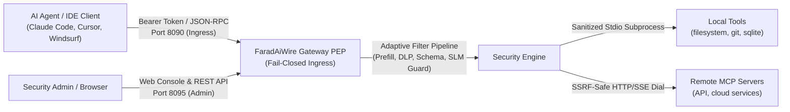

# FaradAiWire Overview 🛡️

**FaradAiWire** is a lightweight, zero-trust security gateway and Policy Enforcement Point (PEP) specifically engineered to protect AI agents (Claude Code, Cursor, Copilot, custom LLM runners) against Model Context Protocol (MCP) threats, prompt injection, sensitive data leakage, and malicious tools.

---

## The Problem: Unchecked Agent Agency

When AI agents execute Model Context Protocol (MCP) tools directly, security boundaries collapse:
- **Indirect Prompt Injection:** Untrusted web or document content returned from tools can hijack agent reasoning and force malicious secondary tool calls (e.g. exfiltrating SSH keys or `.env` secrets).
- **Tool Poisoning & Schema Drift:** Malicious or compromised MCP servers can mutate tool definitions between `tools/list` calls to trick agents into providing privileged arguments.
- **Data Loss & Exfiltration (DLP):** Agents freely pass API keys, credit card numbers, database credentials, and national ID tokens in tool payloads.
- **Infinite Tool Loops:** Hallucinations or circular reasoning can trigger thousands of repeated API calls, causing denial-of-service and massive token billing spikes.

FaradAiWire acts as an **in-line Policy Enforcement Point (PEP)**, inspecting, sanitizing, and authorizing every JSON-RPC tool interaction with microsecond-level latency.

---

## Core Capabilities

| Capability | Execution Layer | Latency SLA | Description |
| :--- | :--- | :--- | :--- |
| **Assistant Prefill Guard** | Fast Path (In-Memory) | $<0.1\text{ ms}$ | Neutralizes sockpuppeting and conversational prefill hijacking attempts. |
| **Runtime JSON Schema Pinning** | Fast Path (In-Memory) | $<0.3\text{ ms}$ | Pins first-seen tool schemas and alerts or blocks runtime schema drift and tool poisoning. |
| **Data Loss Prevention (DLP)** | Fast Path (Regex Engine) | $<0.5\text{ ms}$ | Identifies credentials, private keys, and PII; applies `block` or grammatical `mask` redaction. |
| **Loop & Rate Protection** | Fast Path (Sliding Window) | $<0.1\text{ ms}$ | Token-bucket rate limiting and consecutive duplicate tool call detection (`max_repeat`). |
| **Neural Prompt Injection Guard** | Deep Path (Local SLM) | $15\text{--}40\text{ ms}$ | Optional semantic scoring via local Small Language Models (Qwen3Guard, Prompt-Guard, Granite). |
| **Human-In-The-Loop (HITL)** | Intercept Layer | Interactive | Halts destructive tool actions (`write_to_db`, `send_email`) for CLI or webhook operator confirmation. |
| **Tamper-Evident Telemetry** | Async Logger | Non-blocking | Structured JSONL audit logging and embedded DuckDB analytics with zero remote telemetry egress. |

---

## Architecture Principles

### 1. Physical Port Segregation
FaradAiWire enforces strict port segregation:
- **Port 8090 (Proxy Ingress):** Dedicated to high-throughput agent tool traffic. Operates in fail-closed mode requiring `Authorization: Bearer <API_KEY>`.
- **Port 8095 (Admin Console):** Dedicated to system administration, runtime metrics, Web Console, and configuration inspection. Bound to loopback (`127.0.0.1`) by default.

### 2. Single-Tenant Native Host Daemon (ADR-0051)
FaradAiWire is distributed as a host-native Go binary. Because over 95% of MCP tools operate via local `stdio` subprocesses (`npx`, `python`, `git`), running FaradAiWire directly on the workstation preserves host tool paths, host credentials, and operating system performance without container virtualization overhead.

### 3. Open Core Purity (ADR-0050)
The open-source FaradAiWire Core binary is 100% offline-first and contains zero external cloud dependencies. Enterprise multi-tenant governance, Open Policy Agent (OPA) compiler engines, and centralized fleet control planes are strictly segregated into **FaradAiWire Enterprise Edition (FAWEE)**.

---

## Quick Navigation

- ⚡ **[Quickstart Guide](/docs/wire/01-getting-started/quickstart/):** Launch the gateway and run your first verified tool call in under 5 minutes.
- 📦 **[Installation](/docs/wire/01-getting-started/installation/):** Homebrew, curl shell installer, PowerShell, or building from source.
- 🤖 **[Agent Integration](/docs/wire/01-getting-started/agent-setup/):** Connect Claude Code, Cursor, Windsurf, or custom LLM runners.
- 🛡️ **[Security Filters](/docs/wire/03-security-filters/overview/):** Configure DLP, Neural Prompt Guard, and Schema Validation.
- 📖 **[CLI Reference](/docs/wire/05-cli-reference/overview/):** Master `faradaiwire run`, `doctor`, `audit`, and `guard`.

